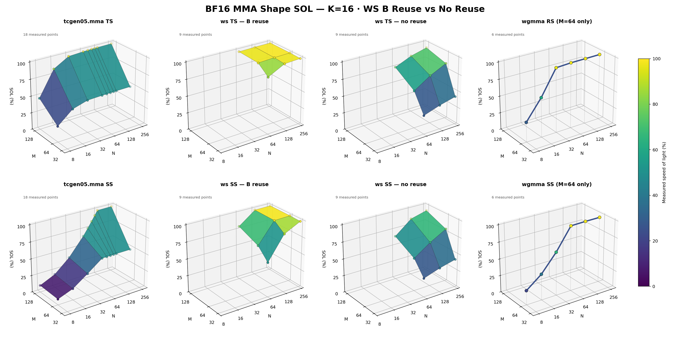

# Mapping Tensor-Core Shape Efficiency on Blackwell and Hopper

Small matrix shapes are common in attention, grouped GEMM, mixture-of-experts,
and fused kernels, but peak tensor-core throughput is usually quoted only for
large, favorable shapes. This note measures the other side of the curve: how
quickly BF16 tensor-core instructions approach their speed of light as `M` and
`N` change, and how operand placement changes the result.

The measurements cover:

- Blackwell B200 `tcgen05.mma` with A in shared memory (`SS`) or tensor memory
  (`TS`).
- Blackwell B200 weight-stationary `tcgen05.mma.ws`, with and without reuse of
  the B collector.
- Hopper H200 `wgmma.mma_async`, with A in shared memory (`SS`) or registers
  (`RS`).

All tables and plots below use BF16 with `K=16`. The benchmark sources and raw
CSV files are published in
[icavan/microbench-blackwell](https://github.com/icavan/microbench-blackwell/tree/icavan/complete-mma-shapes)
and
[icavan/NVIDIA-Hopper-Benchmark](https://github.com/icavan/NVIDIA-Hopper-Benchmark/tree/icavan/complete-wgmma-shapes).

## The result in one figure

The figure contains measured points only. The Hopper instruction has a fixed
architectural `M=64`, so its panels are lines rather than fabricated surfaces.
The Blackwell WS instruction accepts `N=64,128,256` in this benchmark; smaller
`N` encodings trap and are intentionally absent.

Three patterns stand out:

1. Ordinary Blackwell `tcgen05.mma` needs `M=128` to expose the full BF16
   per-SM throughput ceiling. `M=64` asymptotes near 50% SOL.
2. Moving A out of shared memory matters most for small `N`. On Blackwell,
   `M128N8` rises from 10.13% SOL in SS mode to 47.13% in TS mode. On Hopper,
   `M64N32` rises from 64.62% in SS mode to 95.93% in RS mode.
3. Weight-stationary B reuse is not a small reduction in shared-memory bytes;
   it changes the steady-state operand-delivery path. At `M32N64`, TS reuse
   reaches 84.60% SOL while TS no-reuse reaches only 28.13%, a 3.01x throughput
   difference.

## Measurement and normalization

The B200 kernels issue deep steady-state batches and report cycles per MMA
instruction. This is throughput, not single-instruction dependency latency.
For a measured instruction shape, the reported rate is calculated as
`2*M*N*K / cycles_per_MMA`.

The B200 plots normalize this rate against the benchmark's dense per-SM model,
`512*K` FLOP/cycle. For BF16 `K=16`, 100% SOL is therefore 8192 FLOP/cycle.
This normalization makes instruction shapes comparable; it is not a claim
about end-to-end GEMM efficiency or board-level TFLOP/s.

The H200 benchmark launches one warpgroup block per SM and repeats 100,000
WGMMA operations. Each number is the median of five zero-input runs. H200 SOL
is normalized against 989.5 BF16 TFLOP/s.

Operand-mode terminology is architecture-specific:

| Mode | A operand | B operand |
| --- | --- | --- |
| Blackwell SS | shared memory | shared memory |
| Blackwell TS | tensor memory | shared memory |
| Hopper SS | shared memory | shared memory |
| Hopper RS | registers | shared memory |

## Blackwell ordinary tcgen05.mma

The complete BF16 1-SM sweep is below. “TS / SS” compares throughput for the
same instruction shape; because useful work is identical, it is also the
inverse ratio of measured cycles.

| M | N | SS cycles | SS SOL | TS cycles | TS SOL | TS / SS throughput |
|---:|---:|---:|---:|---:|---:|---:|
| 64 | 8 | 23.4736 | 8.52% | 8.4902 | 23.56% | 2.76x |
| 64 | 16 | 23.4863 | 17.03% | 9.4761 | 42.21% | 2.48x |
| 64 | 32 | 24.5087 | 32.64% | 16.4790 | 48.55% | 1.49x |
| 64 | 64 | 32.5541 | 49.15% | 32.4921 | 49.24% | 1.00x |
| 64 | 80 | 40.5541 | 49.32% | 40.4940 | 49.39% | 1.00x |
| 64 | 96 | 48.5541 | 49.43% | 48.4940 | 49.49% | 1.00x |
| 64 | 112 | 56.5541 | 49.51% | 56.4940 | 49.56% | 1.00x |
| 64 | 128 | 64.5541 | 49.57% | 64.4940 | 49.62% | 1.00x |
| 64 | 256 | 128.5541 | 49.78% | 128.4940 | 49.81% | 1.00x |
| 128 | 8 | 39.4701 | 10.13% | 8.4878 | 47.13% | 4.65x |
| 128 | 16 | 39.4833 | 20.26% | 9.4887 | 84.31% | 4.16x |
| 128 | 32 | 40.5112 | 39.50% | 16.4780 | 97.10% | 2.46x |
| 128 | 64 | 48.5559 | 65.90% | 32.4916 | 98.49% | 1.49x |
| 128 | 80 | 52.5687 | 76.09% | 40.4916 | 98.79% | 1.30x |
| 128 | 96 | 56.5853 | 84.83% | 48.4916 | 98.99% | 1.17x |
| 128 | 112 | 60.6009 | 92.41% | 56.4916 | 99.13% | 1.07x |
| 128 | 128 | 64.6186 | 99.04% | 64.4935 | 99.23% | 1.00x |
| 128 | 256 | 128.6146 | 99.52% | 128.4916 | 99.62% | 1.00x |

### Why M64 stops near half peak

The data does not support the idea that the M64 ceiling is simply caused by
using half of TMEM. SS mode has the same approximately 50% ceiling, and TS and
SS converge to nearly identical cycles once `N` is large. The direct
observation is that an M64 instruction produces half as many output elements
as M128 but does not sustain twice the issue rate. TMEM utilization may be part
of the physical implementation, but it is not established by this benchmark.

### Why TS wins by more than the reduction in SMEM bytes

At `M128N8`, TS is 4.65x faster than SS even though moving A to TMEM does not
remove 4.65x of total shared-memory traffic. This shows that small-N SS is not
well described by a bulk-bandwidth roofline. Operand collection, instruction
setup, fixed shared-memory service cost, and tensor-core issue all overlap in a
shape-dependent pipeline. Removing A from the SMEM operand path eliminates a
serialized bottleneck; it does more than halve a byte count.

The advantage disappears when useful tensor work is large enough to dominate.
At `M128N128`, SS and TS both exceed 99% SOL.

## Blackwell tcgen05.mma.ws with B reuse

In the reuse benchmark, B is loaded into collector `b0` before the timed
region. Timed instructions use `collector::b0::use`, and the collector is
released afterward. This isolates the steady-state value of retaining the B
operand.

| M | N | SS cycles | SS SOL | TS cycles | TS SOL | TS / SS throughput |
|---:|---:|---:|---:|---:|---:|---:|
| 32 | 64 | 15.4850 | 51.66% | 9.4567 | 84.60% | 1.64x |
| 32 | 128 | 18.4967 | 86.50% | 16.4806 | 97.08% | 1.12x |
| 32 | 256 | 32.5133 | 98.42% | 32.4806 | 98.52% | 1.00x |
| 64 | 64 | 23.5197 | 68.03% | 16.4816 | 97.08% | 1.43x |
| 64 | 128 | 32.5379 | 98.35% | 32.4801 | 98.52% | 1.00x |
| 64 | 256 | 64.5374 | 99.17% | 64.4802 | 99.26% | 1.00x |
| 128 | 64 | 39.5837 | 80.84% | 32.4816 | 98.52% | 1.22x |
| 128 | 128 | 64.6071 | 99.06% | 64.4792 | 99.26% | 1.00x |
| 128 | 256 | 128.6071 | 99.53% | 128.4816 | 99.63% | 1.00x |

With B reuse, TS reaches at least 97% SOL for every tested shape except
`M32N64`. Even that smallest supported shape reaches 84.60%. Reuse also lets
SS reach full throughput much earlier than ordinary `tcgen05.mma`: `M64N128`
is already at 98.35% SOL.

## Blackwell tcgen05.mma.ws without B reuse

The no-reuse variant uses `collector::b0::discard` on every timed instruction.
B must be fetched from shared memory for every MMA rather than retained in the
collector.

| M | N | SS cycles | SS SOL | TS cycles | TS SOL | TS / SS throughput |
|---:|---:|---:|---:|---:|---:|---:|
| 32 | 64 | 28.4759 | 28.09% | 28.4442 | 28.13% | 1.00x |
| 32 | 128 | 44.4725 | 35.98% | 44.4427 | 36.00% | 1.00x |
| 32 | 256 | 76.4725 | 41.85% | 76.4427 | 41.86% | 1.00x |
| 64 | 64 | 32.4891 | 49.25% | 28.4442 | 56.25% | 1.14x |
| 64 | 128 | 48.4882 | 66.00% | 44.4427 | 72.00% | 1.09x |
| 64 | 256 | 80.4881 | 79.51% | 76.4427 | 83.72% | 1.05x |
| 128 | 64 | 48.5448 | 65.92% | 42.4403 | 75.40% | 1.14x |
| 128 | 128 | 74.5682 | 85.83% | 74.4413 | 85.97% | 1.00x |
| 128 | 256 | 138.5668 | 92.37% | 138.4417 | 92.46% | 1.00x |

When B is fetched for every instruction, TS and SS become almost identical for
M32 and for the larger M128 shapes. That convergence is evidence that B
delivery, rather than A placement, controls the steady state in those cases.

The direct benefit of collector reuse is:

| M | N | SS reuse speedup | TS reuse speedup |
|---:|---:|---:|---:|
| 32 | 64 | 1.84x | 3.01x |
| 32 | 128 | 2.40x | 2.70x |
| 32 | 256 | 2.35x | 2.35x |
| 64 | 64 | 1.38x | 1.73x |
| 64 | 128 | 1.49x | 1.37x |
| 64 | 256 | 1.25x | 1.19x |
| 128 | 64 | 1.23x | 1.31x |
| 128 | 128 | 1.15x | 1.15x |
| 128 | 256 | 1.08x | 1.08x |

Reuse matters most when output work per instruction is small. As the tile gets
larger, tensor-core execution itself amortizes the repeated B-fetch cost and
the speedup approaches one.

## Hopper WGMMA: SS versus RS

Hopper WGMMA fixes the instruction's M dimension at 64. The following table
reports measured board throughput and SOL for every dense BF16 N shape.

| N | SS TFLOP/s | SS SOL | RS TFLOP/s | RS SOL | RS / SS throughput |
|---:|---:|---:|---:|---:|---:|
| 8 | 211.207 | 21.34% | 292.521 | 29.56% | 1.38x |
| 16 | 382.923 | 38.70% | 583.879 | 59.01% | 1.52x |
| 32 | 639.410 | 64.62% | 949.213 | 95.93% | 1.48x |
| 64 | 958.621 | 96.88% | 962.238 | 97.24% | 1.00x |
| 128 | 965.813 | 97.61% | 965.615 | 97.59% | 1.00x |
| 256 | 968.760 | 97.90% | 969.611 | 97.99% | 1.00x |

RS is the clear choice for small N when its register footprint is acceptable.
It moves A off the shared-memory operand path and reaches 95.93% SOL already at
`N=32`, where SS reaches 64.62%. At `N>=64`, both modes are effectively at the
same hardware ceiling, so register pressure and kernel composition become more
important than isolated instruction throughput.

## Kernel-design implications

These measurements suggest a few practical rules:

- Do not assume an instruction's nominal FLOP count predicts throughput. Shape
  determines whether fixed operand-delivery and issue costs are amortized.
- Prefer Blackwell TS for small N when A can be staged in TMEM without creating
  a worse producer-consumer bottleneck. The benefit can be much larger than a
  simple SMEM-byte ratio predicts.
- Use `tcgen05.mma.ws` only when B is genuinely reused. A collector fill outside
  the hot loop turns small shapes from operand-bound into tensor-core-bound;
  issuing `discard` every time leaves much of that benefit unrealized.
- On Hopper, RS is especially valuable at `N=16` and `N=32`. For `N>=64`, SS
  and RS have the same isolated throughput, so choose based on register
  pressure, shared-memory capacity, and surrounding pipeline stages.
- Treat these results as instruction-level ceilings. A production kernel still
  has TMA traffic, synchronization, epilogues, occupancy limits, and scheduling
  overhead that can lower end-to-end SOL.

## Reproducibility

The Blackwell branch contains the ordinary small-N sweep, a dedicated
`umma_ws_throughput` benchmark, explicit reuse/no-reuse modes, and the B200 CSV
files. The Hopper branch contains the BF16 WGMMA source, complete SS/RS shape
sweep, and H200 result CSV. Both implementations explicitly fence shared-memory
publication before asynchronous tensor-core consumers and wait for outstanding
MMA work before releasing storage.

For the exact source and data:

- [Blackwell benchmark branch](https://github.com/icavan/microbench-blackwell/tree/icavan/complete-mma-shapes)
- [Hopper benchmark branch](https://github.com/icavan/NVIDIA-Hopper-Benchmark/tree/icavan/complete-wgmma-shapes)
