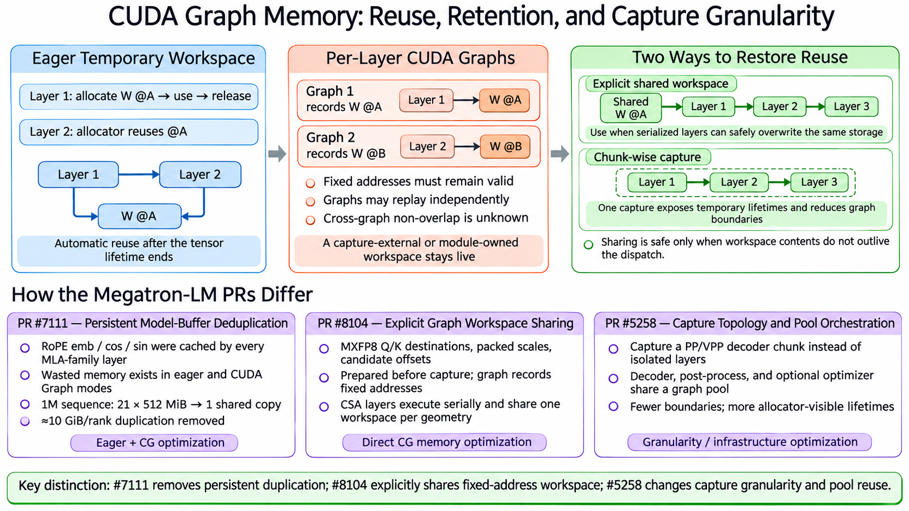

# CUDA Graph Memory: Reuse, Retention, and Capture Granularity

CUDA Graphs reduce CPU launch overhead by recording GPU work once and replaying
it with fixed execution structure. That requirement has an important memory
consequence: kernel arguments include device pointers, so the addresses used by
the graph must remain valid for every replay.

This is often summarized as “CUDA Graphs keep temporary memory alive,” but that
description is too broad. Temporary storage inside one capture can often be
reused automatically. The difficult cases are buffers that cross graph
boundaries, buffers owned by long-lived modules, and workspaces created before
capture because their preparation is not capture-safe.

The distinction is visible in three Megatron-LM changes for long-context
DeepSeek-V4-style training:

- PR #7111 removes duplicated RoPE buffers in both eager and CUDA Graph modes.
- PR #8104 explicitly shares a graph-persistent DSA indexer workspace across
  serialized CSA layers.
- PR #5258 changes capture granularity from isolated layers to decoder chunks
  and coordinates graph-pool reuse.



## Start with three different memory numbers

Before attributing a memory increase to CUDA Graphs, separate these quantities:

| Quantity | What it means |
| --- | --- |
| PyTorch allocated memory | Storage currently owned by live PyTorch tensors |
| PyTorch reserved memory | Segments retained by the caching allocator, including free blocks available for reuse |
| Whole-device usage | CUDA context, NCCL, cuDNN, custom `cudaMalloc`, graph resources, and allocator-managed memory |

`nvidia-smi` reports whole-device usage, not live tensor storage. A large gap
between reserved and allocated memory usually points to caching, fragmentation,
or graph-pool retention. A large gap between whole-device usage and PyTorch
reserved memory points to allocations outside the PyTorch allocator.

The distinction also matters when reading benchmark claims. The Megatron-LM
PRs discussed below report a mixture of peak reserved memory and NVML memory,
while a workload summary may report peak allocated memory. Those values are
useful individually but should not be subtracted from one another as though
they used the same accounting boundary.

## Why eager execution can reuse a temporary workspace

Consider two layers that require the same temporary workspace shape:

```text
Layer 1:
  allocate workspace at address A
  run kernels that consume A
  release the tensor

Layer 2:
  allocate an equivalent workspace
  caching allocator reuses address A
```

“Release” does not necessarily return memory to the CUDA driver. It usually
means the tensor reference disappears and the caching allocator marks the
block as reusable after satisfying stream-ordering requirements.

The important property is that the allocator sees the lifetime boundary. It
knows that Layer 1 no longer owns the block when Layer 2 requests storage.

This automatic reuse does not apply to every eager buffer. A tensor stored on a
module remains live for as long as the module keeps the reference. A cache
registered with `persistent=False` is excluded from `state_dict`; it is not
automatically released after forward.

That last point explains why PR #7111 saves memory in eager mode as well as in
CUDA Graph mode.

## What changes during CUDA Graph capture

During capture, kernel nodes record the pointers used by the captured work.
Replay launches those nodes with the recorded addresses rather than rerunning
Python allocation logic. PyTorch therefore uses graph-private memory pools to
keep captured addresses stable.

This leads to three different lifetime cases.

### Case 1: temporary tensors inside one graph

If a tensor is allocated, consumed, and released during one capture, the
allocator can observe the ordering. Non-overlapping temporaries may reuse the
same graph-pool storage, just as they do in eager execution.

CUDA Graph capture does not imply that every temporary allocation needs a
unique permanent block.

### Case 2: temporary tensors in independent graphs

Suppose Layer 1 and Layer 2 are captured separately:

```text
Graph 1 records workspace A
Graph 2 records workspace B
```

From the allocator's perspective, the two graph executables may be replayed in
a different order or concurrently. It cannot infer from model structure that
Graph 1 always finishes before Graph 2 overwrites the same storage.

PyTorch allows graphs to share a pool when the user can guarantee a safe replay
order, but this is a correctness contract, not a free optimization. Concurrent
or reordered replay can turn apparently harmless reuse into data corruption.

### Case 3: a workspace created before capture

Some workspaces cannot be sized or constructed during capture. Preparation may
perform host synchronization, lazy plan creation, metadata allocation, or
other capture-unsafe work. The framework creates the workspace during eager
warmup, then captures kernels that point to it.

If every layer owns one such workspace, all of them remain live:

```text
Layer 1 owns workspace A  <- Graph 1 records A
Layer 2 owns workspace B  <- Graph 2 records B
Layer 3 owns workspace C  <- Graph 3 records C
```

Sharing a graph pool alone cannot reclaim these blocks because the modules
still hold live references. The ownership model must change explicitly:

```text
Layer 1 --+
Layer 2 --+--> shared workspace A
Layer 3 --+
```

This is safe only when the layers are serialized and no consumer needs the
workspace contents after the next layer overwrites them.

## Capture granularity: layer, chunk, or full iteration

CUDA Graph itself does not require one graph per layer. Frameworks choose a
capture boundary based on dynamic behavior, scheduling, communication, and
correctness constraints.

| Granularity | Typical advantage | Typical cost |
| --- | --- | --- |
| Module or layer | Easy to exclude dynamic MoE or communication regions | More boundaries, static surfaces, and graph instances |
| Decoder chunk | Exposes cross-layer lifetimes and reduces replay count | Requires a stable chunk-level schedule and shapes |
| Full iteration | Maximum launch reduction and broad allocator visibility | Strongest restrictions on control flow, communication, and microbatch scheduling |

In Megatron-LM, the local and Transformer Engine paths commonly capture a
Transformer layer or selected regions such as attention, MLP, or MoE routing.
A single logical layer may still produce multiple graph executables for forward,
backward, shapes, microbatch slots, or precision state.

A chunk-wise graph moves the boundary outward:

```text
one capture {
  Layer 1
  Layer 2
  ...
  Layer N
  recompute and static dispatch/combine work
}
```

The allocator can now see more temporary lifetimes in one capture. The design
also needs fewer boundary tensors between isolated layer graphs. This can lower
memory overhead, but it does not eliminate activations that must survive until
backward, persistent model buffers, or capture-external workspaces.

## Case study 1: PR #7111 shares RoPE buffers

[Megatron-LM PR #7111](https://github.com/NVIDIA/Megatron-LM/pull/7111)
adds an opt-in `share_rotary_pos_emb` path. Identically configured MLA-family
layers reuse one rotary embedding module instead of constructing one cache per
layer.

At a sequence length of 1,048,576 and a positional dimension of 64, the PR
breaks down each layer's rotary storage as:

| Buffer | Type | Size per layer |
| --- | --- | ---: |
| `emb` | FP32 | 256 MiB |
| `cos` | BF16 | 128 MiB |
| `sin` | BF16 | 128 MiB |
| Total | | 512 MiB |

On the measured last pipeline stage, 21 attention layers had identical rotary
configuration. Keeping 21 copies costs approximately 10.5 GiB per rank. The
shared module reduces that to one copy.

The key classification is **persistent model-buffer deduplication**, not a
CUDA-Graph-only optimization. Each layer's rotary module caches its buffers
after lazy construction. Because the module retains those references, eager
execution cannot reuse the allocations either.

The PR reports peak reserved memory changing as follows:

| Mode | Baseline | Shared RoPE | Reduction |
| --- | ---: | ---: | ---: |
| Eager | 137.5 GiB | 125.2 GiB | 12.2 GiB |
| Chunk graph | 156.7 GiB | 146.9 GiB | 9.8 GiB |

The eager result is the clearest evidence that CUDA Graph did not create the
underlying duplication. Graph mode merely adds its own retained resources to a
model that already owns redundant RoPE caches.

## Case study 2: PR #8104 shares the DSA indexer workspace

[Megatron-LM PR #8104](https://github.com/NVIDIA/Megatron-LM/pull/8104)
is the direct CUDA Graph memory optimization among the three examples.

The fused compact DSA indexer used by the cuDNN MXFP8 path needs persistent
storage for:

- MXFP8 Q and K quantization destinations;
- packed scales;
- candidate offsets;
- static geometry and balanced-indexer slot metadata.

Workspace sizing synchronizes with the host, so the workspace must be prepared
during eager warmup. Capture then records its addresses. Before the change,
every CSA layer retained its own warmed-up workspace set.

The optimization introduces a shared `_CompactIndexerWorkspaceStore`, keyed by
model configuration and device, with separate entries where geometry or
balanced-indexer slots genuinely differ. Layers that execute serially on one
stream reuse the same storage.

The safety argument is as important as the allocation change:

1. A layer fills and consumes the workspace during its indexer dispatch.
2. Compact outputs are copied into per-dispatch buffers.
3. Attention and indexer-loss backward use saved BF16 tensors, not the shared
   workspace.
4. The next layer can therefore overwrite the workspace without destroying a
   live value.

The PR describes a workspace instance as roughly 7 GiB per rank for the DSv4
configuration at 16K tokens per rank. Its larger end-to-end validation also
included a linear cross-entropy change, so the reported NVML reduction from
173.8 to 149.4 GiB should not be attributed solely to workspace sharing.

This change is best classified as **explicit graph workspace sharing**. CUDA
Graph's fixed-address requirement turns what could be transient eager storage
into caller-owned persistent state, and the framework restores reuse by proving
that the uses do not overlap.

## Case study 3: PR #5258 changes capture topology

[Megatron-LM PR #5258](https://github.com/NVIDIA/Megatron-LM/pull/5258)
adds chunk-wise, whole-block CUDA Graph support for THD training. It captures
each PP/VPP decoder block as a forward/backward graph pair rather than treating
every layer as an isolated capture unit.

On the last pipeline stage, MTP, the LM head, and loss are captured as a
post-process callable in schedule order. An optional optimizer graph can join
the same pool.

This is primarily a **capture topology and pool-orchestration optimization**:

- fewer graph boundaries and boundary surfaces;
- fewer replay launches;
- more cross-layer temporary lifetimes visible to one capture;
- coordinated pool reuse among decoder, post-process, and optional optimizer
  work;
- capture of recompute and compatible MoE dispatch/combine operations across
  layer boundaries.

It is not equivalent to PR #8104. Chunk-wise capture can automatically reuse
ordinary temporaries whose lifetimes end inside the chunk. It cannot free a
workspace that was created before capture and remains referenced by every
module. That ownership problem still needs explicit sharing.

The two changes therefore complement each other:

```text
PR #5258: make more lifetimes visible inside a larger capture
PR #8104: change ownership for buffers that remain live outside capture
```

## The three optimization classes

| PR | Optimization class | Exists in eager? | Main mechanism |
| --- | --- | ---: | --- |
| #7111 | Persistent model-buffer deduplication | Yes | Share identical RoPE caches across layers |
| #8104 | Explicit graph workspace sharing | Primarily graph-specific | Share capture-external fixed-address DSA workspace across serialized layers |
| #5258 | Capture granularity and pool orchestration | Not applicable to ordinary eager execution | Capture a decoder chunk and coordinate graph-pool reuse |

This classification prevents a common analytical error: treating every memory
improvement measured under CUDA Graph as a graph-private-pool improvement.
Sometimes the model owns duplicate persistent state. Sometimes capture makes a
workspace persistent. Sometimes the graph boundary itself prevents the
allocator from seeing a useful lifetime.

## Why one large graph does not automatically minimize memory

A larger capture exposes more ordering, but memory is still constrained by
true dataflow:

- Activations required by backward must remain live.
- Static graph inputs and outputs require stable addresses.
- Module buffers remain live regardless of capture size.
- Library workspaces may be retained by execution plans or handles.
- Multiple shape buckets may each own a graph and static surfaces.
- NCCL and custom extensions may allocate outside the PyTorch allocator.

A larger graph can also have a higher private-pool high-water mark if many
values genuinely overlap. Capture granularity should therefore be chosen from
measured lifetimes and scheduling constraints, not from the assumption that
“one graph always uses less memory.”

## A practical measurement sequence

Record memory at process startup, after eager warmup, after capture, after the
first replay, and after repeated replay:

```python
import torch


def report(tag: str) -> None:
    free, total = torch.cuda.mem_get_info()
    print(
        tag,
        f"allocated={torch.cuda.memory_allocated() / 2**30:.2f} GiB",
        f"reserved={torch.cuda.memory_reserved() / 2**30:.2f} GiB",
        f"device_used={(total - free) / 2**30:.2f} GiB",
    )
```

Interpret the patterns carefully:

| Observation | Likely direction |
| --- | --- |
| One increase at capture, then stable | Private-pool high-water mark, static buffers, or library workspace |
| Increase for every new shape bucket | Multiple graphs, static surfaces, or per-geometry workspaces |
| Increase on every replay | Retained outputs, hooks, Python references, or repeated recapture |
| Reserved much larger than allocated | Caching, graph-pool retention, or fragmentation |
| Whole-device usage much larger than reserved | cuDNN, NCCL, custom allocator, or CUDA context allocations |

For a suspected cross-layer workspace, inspect ownership as well as allocation
sites. If every module stores the workspace in a field or list, the allocator
cannot reclaim it even when all kernels execute serially.

## Design rules for safe reuse

When introducing explicit sharing, verify all of the following:

1. Every user of the workspace is serialized by the same stream or explicit
   dependencies.
2. No replay can run concurrently with another replay that writes the same
   storage.
3. No output, backward pass, or delayed communication operation reads the
   workspace after the dispatch finishes.
4. Geometry, dtype, alignment, and size are part of the sharing key.
5. Warmup prepares every geometry that capture may select.
6. A debug option can restore private per-layer workspaces when diagnosing
   correctness.

Sharing based only on matching allocation sizes is insufficient. The proof is
about lifetime and execution order, not just shape compatibility.

## Takeaway

CUDA Graph records fixed addresses, but fixed addresses are only part of the
memory story.

- PR #7111 removes duplicated persistent RoPE caches that waste memory in both
  eager and graph execution.
- PR #8104 restores eager-like workspace reuse by explicitly sharing a
  capture-external fixed-address buffer across serialized layers.
- PR #5258 expands the capture boundary so more temporary lifetimes become
  allocator-visible and related graphs can share a coordinated pool.

The useful diagnostic question is not simply “Does CUDA Graph use a private
pool?” It is:

> Who owns this buffer, which graph records its address, and when can the next
> user safely overwrite it?

Answering those three questions usually identifies whether the right fix is
buffer deduplication, explicit workspace sharing, graph-pool sharing, or a
different capture boundary.

## References

- [PyTorch CUDA semantics: CUDA Graphs](https://docs.pytorch.org/docs/stable/notes/cuda.html#cuda-graphs)
- [NVIDIA CUDA Programming Guide: CUDA Graphs](https://docs.nvidia.com/cuda/cuda-programming-guide/04-special-topics/cuda-graphs.html)
- [Transformer Engine and Megatron-LM CUDA Graph support](https://docs.nvidia.com/dl-cuda-graph/latest/torch-cuda-graph/te-megatron-cuda-graphs.html)
- [Megatron-LM PR #7111: share rotary position embeddings](https://github.com/NVIDIA/Megatron-LM/pull/7111)
- [Megatron-LM PR #8104: share the compact DSA indexer workspace](https://github.com/NVIDIA/Megatron-LM/pull/8104)
- [Megatron-LM PR #5258: chunk-wise CUDA Graph support for THD training](https://github.com/NVIDIA/Megatron-LM/pull/5258)
