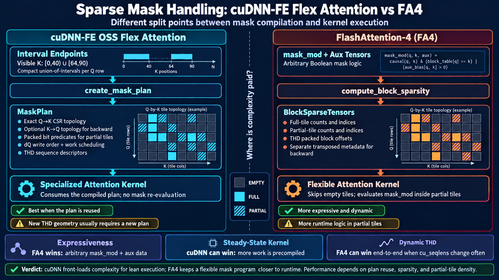

# cuDNN-FE Flex Attention 与 FA4 的 Sparse Mask 设计对比

本文对比两种不同的 sparse-mask 处理路线：

- cuDNN Frontend OSS `flex_attention`：使用 **interval endpoints** 描述 mask，再将其编译成可复用的
  `MaskPlan`；
- FlashAttention-4（FA4）：使用 **`mask_mod + aux tensors`** 表达 mask，并用
  `BlockSparseTensors` 提供 block 级稀疏拓扑。

这里讨论的 FA4 THD backward 能力特指
[`icavan/media-thd-block-sparse`](https://code.alipay.com/ling/flash-attention?ref=icavan%2Fmedia-thd-block-sparse)
分支。不同 FA4 版本和分支的具体字段及支持范围可能不同。

## 1. 核心结论

两套设计最重要的区别不是 CSR 和 ELL 的区别，而是**在哪里完成 mask 编译**：

```text
cuDNN-FE OSS
interval endpoints
    -> create_mask_plan
    -> exact sparse topology + partial-tile predicates + scheduling
    -> specialized attention kernel

FA4
mask_mod + aux tensors
    -> compute_block_sparsity
    -> full/partial block topology
    -> flexible attention kernel re-evaluates mask_mod in partial tiles
```

因此：

- cuDNN 将更多工作前移到 planner，以换取更简单、更专用的 attention kernel；
- FA4 保留一个更通用的 mask program，表达能力和动态性更强；
- cuDNN 是否端到端更快，主要取决于 `MaskPlan` 能否被足够多的层和调用复用；
- THD 中如果 `cu_seqlens` 经常变化，cuDNN 的重新建 plan 成本可能抵消执行阶段的优势。

## 2. 三个容易混淆的概念

### 2.1 Interval endpoints：高层 mask 语言

cuDNN-FE 的 `mask_func` 虽然保留了 `func` 这个名字，实际上传入的是一个 CUDA `int32`
tensor：

```text
mask_func[Hmask, nfunc, total_q]
```

某个 Q row 的 endpoints：

```text
[40, 64, 90]
```

表示：

```text
visible K = [0, 40) U [64, 90)
```

它描述的是 token 级精确语义，而不是 block 列表。`nfunc` 必须是正奇数，每行 endpoints
单调不减。在 THD 模式下，endpoint 仍然是所属 sequence 内的 sample-local K 坐标，而不是
flattened K tensor 的全局位置。

这种表达对 causal、sliding window、document mask，以及每行由少量区间构成的 mask 很紧凑。
但如果一行存在大量离散可见点，就需要大量 endpoints，表达效率会下降。

### 2.2 BlockSparseTensors：block 级执行拓扑

FA4 的 `BlockSparseTensors` 告诉 kernel：

- 哪些 K tiles 对当前 Q tile 完全可见；
- 哪些 K tiles 部分可见；
- 哪些 tiles 为空，可以完全跳过。

在前述 THD 分支中，其主要字段包括：

```text
mask_block_cnt
mask_block_idx
full_block_cnt
full_block_idx
cu_total_m_blocks
cu_block_idx_offsets
block_size
dq_write_order
dq_write_order_full
spt
```

它不是完整的 token-level mask。对 partial tile，kernel 仍需执行 `mask_mod`，才能确定 tile
内部每个 score element 是否有效。

### 2.3 MaskPlan：编译后的完整消费对象

cuDNN 的 `MaskPlan` 不只是 block-sparse 索引。它包含或拥有：

- Q-to-K 的 exact compact CSR topology；
- backward 需要的 K-to-Q topology；
- partial tiles 的 packed bit predicates；
- `dq_write_order` 等 backward 写入顺序；
- `sequence_desc` 和 `fwd_work_desc` 等 sequence/scheduling metadata；
- THD sequence prefixes 的 owned clones；
- 与目标 consumer、架构、tile geometry 和 MMA ownership 对应的 plan signature。

attention kernel 消费 plan 时不再重新解释 endpoints，也不再执行通用的 mask function。

## 3. 用同一个 mask 看两种 lowering

假设一条 Q row 的 K 长度为 128，逻辑 K block size 为 32：

```text
visible K = [0, 40) U [64, 90)

K block 0: [  0,  32) -> FULL
K block 1: [ 32,  64) -> PARTIAL
K block 2: [ 64,  96) -> PARTIAL
K block 3: [ 96, 128) -> EMPTY
```

### cuDNN-FE lowering

公开输入可以直接写成：

```text
endpoints = [40, 64, 90]
```

planner 会生成概念上类似以下内容：

```text
full_count    = [1]
full_offset   = [0, 1]
full_index    = [0]

partial_count  = [2]
partial_offset = [0, 2]
partial_index  = [1, 2]

mask_block_masks = exact packed predicates for blocks 1 and 2
```

其中 CSR topology 决定需要处理哪些 tiles，`mask_block_masks` 则给出 partial tile 内部的精确
token predicate。

### FA4 lowering

FA4 的 block metadata 可概念化为：

```text
full_block_cnt = 1
full_block_idx = [0]

mask_block_cnt = 2
mask_block_idx = [1, 2]
```

block 3 不进入工作集合。blocks 1 和 2 只是被标记为 partial；kernel 随后执行 `mask_mod`
来恢复它们内部的精确可见性。

## 4. `mask_mod`、aux tensors 与 endpoints

FA4 的 `mask_mod` 可以看作一个逐 score-element 的 Boolean program，例如：

```python
def mask_mod(batch, head, q_idx, k_idx, document_id):
    return (k_idx <= q_idx) & (document_id[q_idx] == document_id[k_idx])
```

这里的 `document_id` 就是 aux tensor：它不是 Q/K/V，也不是 block-sparse metadata，而是
mask program 读取的额外数据。

这种接口可以表达：

- causal/window/document mask 的任意组合；
- lookup-table、block table 或 token label 驱动的 mask；
- 无法自然压缩为少量连续区间的离散关系。

cuDNN endpoints 的表达域更窄：每个 Q row 必须表示成固定数量的有序区间并集。它的好处是
planner 更容易进行完整静态分类和专用化；代价是复杂、动态或高度离散的 mask 不够自然。

## 5. THD/variable-length 模式

### 5.1 cuDNN-FE

THD 输入通过 `cu_seqlens_q` 和 `cu_seqlens_k` 给出 sequence 边界。planner 会：

1. 根据 prefixes 建立 compact Q/K plan-row prefixes；
2. 在每个 sample 内完成 empty/full/partial 分类；
3. 生成 exact CSR、partial predicates 和 schedule；
4. 在 `build_backward=True` 时生成 backward topology 和 dQ ordering。

plan 与实际的 sequence geometry 绑定。Q/K/V tensor 的 identity 不属于绑定的一部分，因此同一
geometry 下的新 Q/K/V 值可以复用 plan；但是 `cu_seqlens` 的值发生变化时，sample partition、
block-row 数量和 topology 通常都会改变，需要重新构建 plan。

只要以下条件一致，一个 plan 可以跨 Transformer layers 复用：

- mask endpoints 相同；
- `cu_seqlens_q/k` 和最大 sequence lengths 相同；
- Q/K/V geometry、head mapping 和 direction 相容；
- consumer signature 和目标架构相容。

### 5.2 FA4

FA4 THD metadata 将每条 sequence 的 block rows 打包在一起，并通过 block-prefix/offset metadata
定位每条 sequence 的局部索引区域。

forward 从 Q block rows 枚举 K blocks；backward 的部分阶段需要反向关系，即从 K block rows
枚举 Q blocks。因此 THD sparse backward 不能只把 forward metadata 原样传入。在前述分支中，
调用方额外传入 `block_sparse_tensors_bwd`，其中保存转置后的 block topology 和相应 dQ write
ordering。

这使 FA4 保留了灵活的 mask 接口，但把 forward/backward metadata 的构建和配对责任更多地留给
了上层。

## 6. 详细对比

| 维度 | cuDNN-FE OSS Flex Attention | FA4 |
|---|---|---|
| 高层 mask 接口 | Interval endpoints tensor | `mask_mod + aux tensors` |
| 表达能力 | 每个 Q row 的有序区间并集 | 通用 Boolean mask program |
| Sparse metadata | `MaskPlan` 内 exact CSR | `BlockSparseTensors` 的 full/partial tile lists |
| Empty tile | planner 删除 | block topology 跳过 |
| Full tile | 无需 token-level 判断 | 无需执行 partial mask path |
| Partial tile | planner 生成 packed bit predicates | kernel 内执行 `mask_mod` |
| Backward | plan 可预建 K-to-Q topology 和 dQ ordering | 需要单独的转置 sparse metadata |
| THD coordinates | endpoints 为 sample-local K positions | block indices 为 sequence-local，再由 packed offsets 定位 |
| Metadata compactness | final indices 按 exact nnz 分配；另有 partial-bit payload | 分支实现偏 capacity/ELL-like index storage |
| Kernel specialization | 强：plan 与 consumer layout/signature 绑定 | 强，但 mask program 更靠近执行期 |
| 动态 geometry | 较弱：新 `cu_seqlens` 通常要新 plan | 接口更自然，但仍需重建对应 sparse metadata |
| 跨层复用 | 同 geometry/mask 时价值很高 | block metadata 同样可复用 |
| API 复杂度 | planner 和 plan 生命周期更明显 | mask 表达直观，但 FWD/BWD metadata 配对更显式 |

## 7. 优劣势评价

### cuDNN-FE 的优势

- attention kernel 不需要重新解释 mask，partial-tile 判断已编译为 consumer-specific bit payload；
- exact CSR 和预计算 schedule 可以降低执行期控制流与 metadata 浪费；
- forward/backward 所需拓扑、tail protection 和写入顺序由一个 plan 统一管理；
- plan 能跨多层或多次调用复用时，planner 成本容易被摊薄。

### cuDNN-FE 的劣势

- endpoints 的表达能力弱于通用 `mask_mod`；
- plan 依赖 sequence geometry 和 consumer signature，缓存 key 与生命周期管理更复杂；
- 动态 THD batch 中，频繁变化的 `cu_seqlens` 会导致频繁重建；
- 单次调用或短生命周期 workload 可能无法摊薄 planner 和同步成本。

### FA4 的优势

- `mask_mod + aux tensors` 能自然表达复杂、离散和数据驱动的 mask；
- block topology 和 token-level predicate 分层，接口更适合动态图和实验性 mask；
- 不需要把所有 partial predicates 提前物化成 consumer-specific bit payload；
- 动态 THD 场景更容易围绕当前 batch 直接生成 metadata。

### FA4 的劣势

- partial tiles 内仍存在 mask program 的执行、地址计算和控制流成本；
- backward 需要转置 topology，THD 下还涉及 packed offsets 和 dQ write ordering；
- 上层必须保证 forward/backward sparse metadata 一致；
- 如果 mask 和 geometry 长期稳定，没有完全利用“提前编译后重复执行”的机会。

## 8. 性能判断模型

不能只比较 attention kernel 时间，而应比较摊销后的端到端成本：

```text
T_cuDNN = T_create_mask_plan / reuse_count
        + T_specialized_attention

T_FA4   = T_build_block_sparse_metadata / reuse_count
        + T_flexible_attention
```

cuDNN 更可能占优的情况：

- 同一 THD packing 和 mask 被几十层共享；
- 同一个 plan 被 forward/backward 或多次迭代复用；
- partial-tile 密度高，运行时 `mask_mod` 成本明显；
- exact sparse topology 能显著减少无效 tile 工作。

FA4 更可能端到端占优的情况：

- 每一步的 `cu_seqlens` 或 mask 都变化；
- mask 难以表示为少量 interval unions；
- plan 只能使用一次或很少次数；
- 动态性和开发灵活性比最大化 steady-state kernel 性能更重要。

最终没有普适赢家：cuDNN 优化的是 **compile once, execute many**；FA4 优化的是
**keep the mask programmable while skipping empty blocks**。

## 9. 参考实现

- [cuDNN-FE Flex Attention public API](https://github.com/NVIDIA/cudnn-frontend/blob/main/docs/fe-oss-apis/attention/flex_attention.md)
- [cuDNN-FE MaskPlan design](https://github.com/NVIDIA/cudnn-frontend/blob/main/docs/fe-oss-apis/attention/flex_attention_design.md)
- [FA4 THD block-sparse branch](https://code.alipay.com/ling/flash-attention?ref=icavan%2Fmedia-thd-block-sparse)

## Appendix A: Visual Summary


