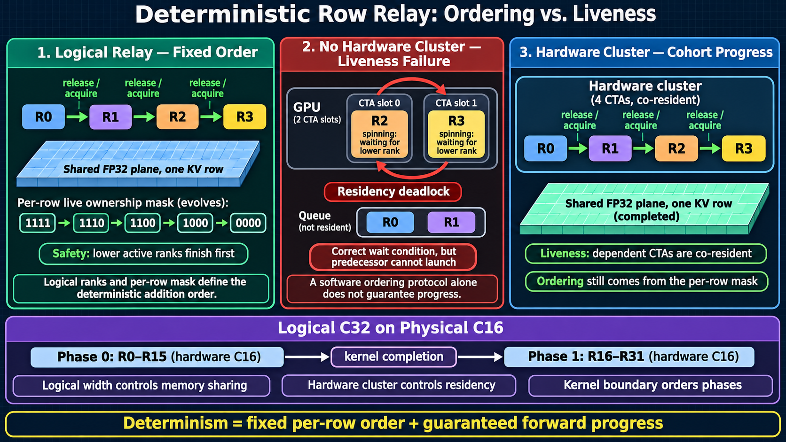

# Deterministic GPU Row Relays: Why Software Ordering Still Needs a Hardware Cluster



A deterministic sparse backward kernel has to solve two different problems:

1. **Safety:** every contribution to one output row must be added in a fixed order.
2. **Liveness:** every participant required by that order must eventually run.

The row-relay protocol solves safety with a logical rank order, a per-row ownership mask, and release/acquire memory ordering. A hardware thread-block cluster solves liveness by admitting the dependent CTAs as one co-resident cohort.

This distinction is easy to miss. The logical relay group is indeed a software concept, but a software dependency chain does not control which CTAs the GPU scheduler makes resident. In the one-CTA-per-rank, single-kernel design described here, removing the hardware cluster can turn a correct wait condition into a residency deadlock.

The concise conclusion is:

> The per-row mask defines **who must go next**. The hardware cluster ensures that the CTA which must go next is **actually able to run**.

This article complements [Deterministic DSA Backward: From Private FP32 Shards to Row-Aware Cluster Relays](DSA_BACKWARD_DETERMINISM_PRIVATE_SHARDS_TO_CLUSTER_RELAYS.md), which covers the larger memory and performance trade-off.

## Three Terms That Must Not Be Conflated

The word *cluster* is often overloaded. A precise description needs three independent quantities.

| Quantity | Meaning | Example |
|---|---|---:|
| Logical relay width | Number of software ranks sharing one FP32 accumulation plane | 32 |
| Physical hardware cluster size | Number of CTAs admitted as one cluster cohort in one kernel phase | 16 |
| Relay phase count | Number of ordered hardware-cluster phases needed to cover the logical group | 2 |

For a 128-CTA query wave, logical relay width `C` determines the number of full FP32 planes:

```math
P = \frac{128}{C}
```

Thus logical `C32` uses four planes, even when the hardware executes it as two ordered physical `C16` phases. The logical width controls memory sharing. The physical cluster size controls the scheduling envelope of each phase.

In general:

```math
N_{\mathrm{phases}} = \frac{C_{\mathrm{logical}}}{C_{\mathrm{physical}}}
```

when the logical width is an integer multiple of the physical cluster size.

## Why a Fixed Addition Order Is Necessary

Floating-point addition is not associative. Consider three FP32 contributions to one output element:

```text
a = 100,000,000
b = -100,000,000
c = 1
```

Two valid execution orders can produce different results:

```text
(a + b) + c  -> 1
a + (b + c)  -> 0
```

In a sparse backward kernel, many query CTAs may select the same KV row and accumulate into the same `dKV` element. An ordinary `atomicAdd` serializes each individual update, but it does not promise a repeatable ordering between CTAs. The numerical result may be acceptable while its bits change between runs.

Determinism therefore requires an addition order derived from stable data, not from arrival time.

## The Logical Row-Relay Protocol

Suppose four software ranks share one FP32 plane for a particular KV row. A setup step computes the exact set of writers from the runtime sparse indices. For a row written by all four ranks, the live mask begins as:

```text
rank:  3 2 1 0
mask:  1 1 1 1
```

Rank `r` may update the row only when no active lower rank remains. Its dependency mask is:

```math
L_r = M \mathbin{\&} \left((1 \ll r)-1\right)
```

The rank waits until:

```math
L_r = 0
```

For the full four-rank writer set, ownership evolves as follows:

```text
1111  --R0 completes-->  1110
1110  --R1 completes-->  1100
1100  --R2 completes-->  1000
1000  --R3 completes-->  0000
```

The handoff is a release/acquire protocol:

1. Rank `r` waits with acquire semantics until all lower active bits are clear.
2. It reads the FP32 values produced by its predecessors.
3. It adds its contribution to the shared plane.
4. It publishes the completed update and clears its bit with release semantics.

This creates a fixed per-row order. A different row can have a different writer set, such as `{0, 3}`, and advances independently. The protocol orders only real conflicts instead of serializing the whole grid.

That is the **safety proof**. It says that if every participating rank runs, the row receives contributions in a repeatable order.

It does not yet prove that every rank can run.

## The Deadlock Schedule Without a Hardware Cluster

Consider a deliberately small GPU model with two resident CTA slots and four independently scheduled CTAs:

```text
Required order: R0 -> R1 -> R2 -> R3

Resident slot 0: R2, spinning until R0 and R1 clear
Resident slot 1: R3, spinning until R0, R1, and R2 clear

Launch queue:    R0, R1
```

The wait conditions are logically correct. `R2` must not pass `R0` or `R1`, and `R3` must not pass any lower active rank.

But both resident slots are now occupied by successors. The predecessors are queued and cannot become resident. The successors cannot retire because their predecessors have not run. The predecessors cannot run because the successors have not retired.

This is a residency deadlock:

```text
R2 and R3 hold residency while waiting
                 |
                 v
R0 and R1 cannot acquire residency
                 |
                 v
R2 and R3 can never observe completion
```

Neither atomics nor memory fences fix this problem. They control visibility and ordering of memory operations; they do not force the GPU scheduler to admit a non-resident predecessor.

CUDA also does not provide a general forward-progress guarantee for arbitrary inter-CTA spin dependencies in an ordinary grid. A grid can contain far more CTAs than fit concurrently, so software must not assume that a particular unscheduled CTA will appear while all resident resources are held by waiters.

## What the Hardware Cluster Contributes

A hardware thread-block cluster gives the relay a bounded scheduling domain. The dependent CTAs in one phase are admitted as a cluster cohort rather than as unrelated blocks.

For a physical `C16` phase:

```text
hardware cluster = {R0, R1, ..., R15}
```

Every possible predecessor for a rank in that phase belongs to the same admitted cohort. A successor may still arrive at the mask check earlier than its predecessor, but it is no longer waiting for a CTA stranded outside the residency envelope. The predecessor has execution resources within the same cluster and can make progress.

The hardware cluster therefore supplies a **liveness invariant**:

> A resident relay rank never depends on an unscheduled rank outside its hardware-cluster cohort.

It is important not to overstate this guarantee:

- The hardware cluster does **not** define the numerical order. The rank mask does.
- The hardware cluster does **not** replace release/acquire ordering. The memory protocol still publishes each predecessor's FP32 writes.
- The hardware cluster does **not** make all CTAs execute instruction-for-instruction in lockstep. It supplies the co-resident scheduling envelope needed for forward progress.

Safety and liveness remain separate:

| Property | Mechanism |
|---|---|
| Fixed writer order | Logical ranks and per-row ownership mask |
| Visibility of predecessor writes | GPU-scope release/acquire operations and fences |
| Forward progress of the dependency cohort | Hardware thread-block cluster |
| Order between relay phases | Kernel completion in one CUDA stream |

## Why Logical C32 Can Be Two Physical C16 Phases

Logical `C32` means 32 ranks share one plane in a fixed order. It does not require a single physical cluster containing 32 CTAs.

The lowering can be:

```text
Phase 0: R0  ... R15   in one physical C16 cluster
          |
          | kernel completion in the same stream
          v
Phase 1: R16 ... R31   in one physical C16 cluster
```

Within phase 0, the hardware cluster guarantees liveness and the mask orders ranks `0..15`. Kernel completion then creates a global happens-before edge before phase 1 starts. Within phase 1, another physical `C16` cluster guarantees liveness while the mask orders ranks `16..31`.

The complete logical order is therefore:

```text
R0 -> R1 -> ... -> R15 -> kernel boundary -> R16 -> ... -> R31
```

The same idea extends to logical `C64` as four physical `C16` phases.

| Logical width | Full FP32 planes in a 128-CTA wave | Typical physical phases |
|---:|---:|---:|
| 4 | 32 | one C4 phase |
| 8 | 16 | one C8 phase |
| 16 | 8 | one C16 phase |
| 32 | 4 | two ordered C16 phases |
| 64 | 2 | four ordered C16 phases |

Larger logical widths reduce the dominant plane workspace, but add ordered phases and can reduce throughput. They are memory/performance choices, not different mathematical operations.

## Why Not Build a Physical C32 Cluster?

A physical cluster is constrained by the architecture, launch rules, and the resources consumed by each CTA. Even if a future architecture accepts a larger physical cluster for some kernels, the design should not equate logical relay width with physical cluster size.

Keeping the two concepts separate has several benefits:

- A logical `C32` or `C64` memory policy can run on a physical `C16` execution primitive.
- The public tuning vocabulary describes the memory/performance trade-off rather than exposing an architectural accident.
- The compiler can lower one logical policy differently on different GPU families.
- Resource-heavy CTAs are not forced into a physical cohort larger than the hardware can admit efficiently.

The price is extra phase boundaries. Whether logical `C32` or `C64` wins depends on the workspace constraint, mask overhead, phase-launch cost, and the amount of useful parallel work in the shape.

## Is Hardware Clustering Fundamentally Required for Every Relay?

No. It is required for this particular combination:

- one CTA per logical rank,
- inter-CTA spin waiting,
- multiple dependent ranks in one kernel phase,
- and no independent software scheduler that can guarantee predecessor execution.

Other designs can establish liveness in different ways:

1. **One CTA processes several logical ranks sequentially.** No inter-CTA dependency exists, but parallelism falls.
2. **One kernel launch per logical rank.** Stream order supplies the dependency, but launch count becomes excessive.
3. **A persistent kernel with an internal work scheduler.** A fixed resident set can process ready ranks, but the scheduler and proof are more complex.
4. **Private accumulation planes followed by a fixed reduction.** This removes temporal waiting at the cost of much larger memory.

So the precise claim is not “determinism always requires a hardware cluster.” It is:

> A single-kernel CTA-per-rank relay with spin dependencies needs a residency guarantee; a hardware thread-block cluster is the direct and efficient mechanism used to provide it.

## CUDA Graph Compatibility

The phase structure remains CUDA Graph friendly when all workspace sizes and launch choices are derived before capture:

- mask setup has fixed allocations and no host polling;
- each relay phase is an ordinary captured kernel node;
- same-stream graph dependencies preserve phase order;
- no device-wide dynamic launch or host-side semaphore loop is required;
- replay reuses the same graph topology and stable workspace addresses.

Logical `C32` and `C64` add graph nodes, but they do not require graph mutation on every replay. The chosen logical width should be part of plan construction or a stable tuning record.

## Review Checklist for a High-Quality Relay

A deterministic implementation should answer all of the following questions explicitly.

### Ordering

- Is the writer set for each row exact and schedule-independent?
- Is the rank order fixed for every active writer set?
- Do release operations publish FP32 writes before ownership is handed off?
- Do successor loads use matching acquire semantics at GPU scope?
- Is the final plane reduction tree fixed?

### Liveness

- Can a resident CTA wait for a CTA that is not resident?
- Are all possible predecessors inside the same hardware-cluster cohort?
- Can a barrier be reached by only a subset of the CTA because of divergent control flow?
- Is every phase transition protected by a real kernel-completion dependency?

### Resource and launch behavior

- Is the requested physical cluster legal for the target architecture and kernel resources?
- Does the implementation fall back cleanly when the preferred cluster configuration is unavailable?
- Are logical width, physical cluster size, and phase count reported separately in diagnostics?
- Are workspace and performance measured for every exposed logical width?

### Graph behavior

- Are allocations complete before capture?
- Does replay avoid host synchronization and data-dependent graph topology changes?
- Are all phase and reduction dependencies represented in the captured graph?

## Final Takeaway

The relay is easiest to reason about when its proof is split in two:

```text
Deterministic correctness
    = fixed per-row addition order
    + visibility of predecessor writes
    + guaranteed forward progress
```

The logical relay and its release/acquire mask provide the first two terms. The hardware cluster provides the third for each single-kernel phase. Larger logical widths such as `C32` and `C64` remain software concepts; they can be composed from ordered physical `C16` phases, with kernel completion carrying the happens-before relation across phases.

That is why the design uses both abstractions. The logical group says what the deterministic computation means. The hardware cluster makes that computation schedulable without risking a residency deadlock.
