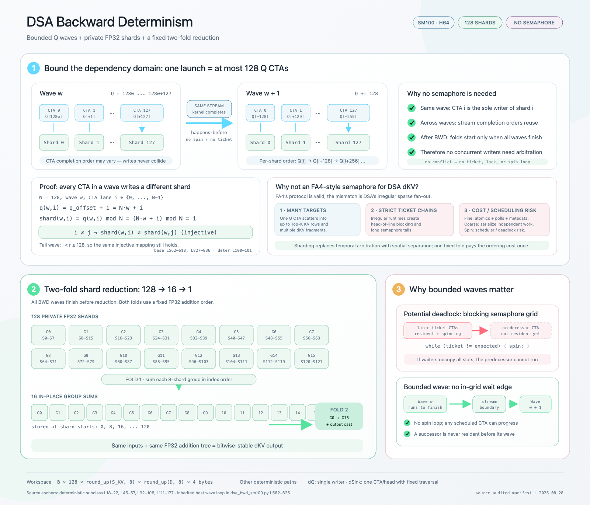
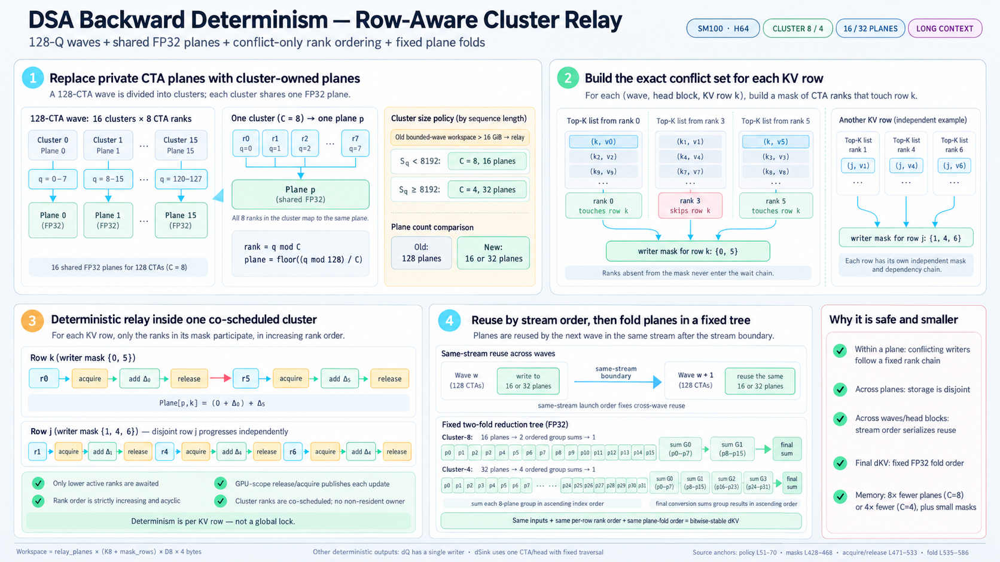

# Deterministic DSA Backward: From Private FP32 Shards to Row-Aware Cluster Relays

DeepSeek Sparse Attention (DSA) backward has an awkward determinism problem. Every query touches only a Top-K subset of a long KV sequence, but many queries can select the same KV row. Their `dKV` contributions therefore collide, and ordinary global `atomicAdd` makes the FP32 accumulation order depend on GPU scheduling.

The first deterministic SM100 implementation solved this by eliminating collisions altogether: bound each query wave, give every query CTA a private FP32 shard, and reduce the shards in a fixed tree. That design is simple, fast for moderate KV lengths, and requires no semaphore. Its weakness appears at million-token context, where 128 full-size FP32 shards can consume hundreds of GiB.

The second design keeps the bounded wave and fixed final reduction, but replaces CTA-private shards with cluster-owned planes. CTAs sharing a plane use a packed, row-specific rank mask as a local acquire/release relay. Only writers that actually collide on the same KV row are ordered. This hybrid of spatial separation and fine-grained temporal ordering reduces the dominant workspace by up to 16x before mask overhead, while preserving a fixed addition order and CUDA Graph-safe execution.

The two implementations are represented by [cuDNN Frontend PR #810](https://github.com/NVIDIA/cudnn-frontend/pull/810) and [PR #1770](https://github.com/NVIDIA/cudnn-frontend/pull/1770).

This comparison focuses on the generic SM100-family M64 deterministic path. The specialized H128 D512/D576 two-CTA envelopes retain their separate fixed-owner design.

## TL;DR

- Deterministic `dKV` requires a repeatable FP32 addition order for all query CTAs that update the same KV row. It does not require all sparse work to be globally serialized.
- **Version 1 uses pure spatial separation.** A bounded wave selects 32, 64, or 128 private FP32 shards. Each CTA is the sole writer of its shard, later waves reuse shards in stream order, and a fixed `128 -> 16 -> 1` tree handles the largest specialization.
- Version 1 needs no semaphore and has a short correctness proof, but its large-query workspace is dominated by `128 * K8 * D8 * sizeof(float)`. At 1M KV and D576, the full scratch reaches about 288 GiB.
- **Version 2 combines spatial separation with conflict-only temporal ordering.** A 128-CTA wave is divided into clusters of 4, 8, or 16 CTAs, leaving 32, 16, or 8 FP32 planes. CTAs in one cluster share a plane.
- A setup kernel derives the exact writer set for every `(query wave, head block, KV row)` from the runtime Top-K indices. Writers to one row relay ownership in increasing cluster-rank order using GPU-scope acquire/release operations; unrelated rows continue independently.
- The new protocol is semaphore-like, but it is not a grid-wide semaphore. Every possible predecessor belongs to the same co-scheduled thread-block cluster, so no resident CTA waits for an unscheduled owner.
- The final plane fold remains fixed. Identical inputs therefore follow the same per-row rank order, wave order, and plane-reduction tree.
- For H64, Dqk576, Dv512, Q=16K, Top-K 2048, and KV=1M, the measured full scratch falls from **288.008 GiB to 20.008 GiB**, a **93.1% reduction**. The upstream allocation does not fit on the 185 GiB test GPU.
- The relay is not universally faster. Near its branch-entry thresholds it may trade latency for memory, while the measured D576 small-/medium-Q long-KV shapes improve by 1.6-3.2x because they avoid clearing and folding 128 mostly wasteful planes.
- Both versions are deterministic within a fixed specialization. They are not required to be bitwise identical to each other because changing the plane count changes the FP32 reduction grouping.

## Why Sparse dKV Is Nondeterministic

For a KV row `k` and feature dimension `d`, DSA backward conceptually accumulates contributions from every query and head whose sparse index set contains `k`:

```math
dKV[k,d] = \sum_{q,h:\,k \in I(q)} \Delta_{q,h,k,d}
```

Here `I(q)` is the active Top-K index set for query `q`. The mathematical sum is well defined, but floating-point addition is not associative:

```math
(a+b)+c \ne a+(b+c)
```

If several CTAs issue `atomicAdd` operations to the same FP32 element, the hardware-visible serialization order may vary from run to run. The output can remain numerically accurate while failing bitwise reproducibility.

The determinism requirement can therefore be stated more narrowly:

> For each output element, make the order of all contributing FP32 additions independent of CTA scheduling.

`dQ` and `dSink` are easier. The deterministic DSA path gives `dQ` a single writer and computes `dSink` with one CTA per head using a fixed traversal. The difficult output is `dKV`, whose sparse fan-in couples many queries to an irregular set of KV rows.

## Version 1: Bounded Waves and Private FP32 Shards

The first design removes write conflicts by construction.



### Bound the dependency domain

Queries are processed in same-stream waves. For the largest specialization, one launch contains at most 128 query CTAs. Let `w` be the wave number and `i` the CTA lane within that wave:

```math
q(w,i) = 128w + i
```

Each lane writes shard:

```math
\mathrm{shard}(w,i) = q(w,i) \bmod 128 = i
```

Within a wave, the mapping is injective: different CTAs always write different shards. CTA completion order can vary without changing any accumulation order because their storage never overlaps.

Later waves reuse the same 128 shards, but they are separate kernel launches in one CUDA stream. Stream ordering gives a happens-before edge from wave `w` to wave `w+1`; no in-grid spin loop or ticket is needed.

The production policy reduces the shard count for small query batches:

| Declared query extent | Private dKV shards |
|---:|---:|
| `Q <= 128` | 32 |
| `129 <= Q <= 256` | 64 |
| `Q > 256` | 128 |

The wave size follows the selected shard count. This preserves enough parallelism on SM100 while avoiding the full 128-plane allocation for genuinely small Q.

### Fold shards in one fixed tree

After all backward waves finish, the 128-shard specialization performs a two-stage FP32 reduction:

1. Sum each consecutive group of eight shards in ascending shard order, producing 16 group sums.
2. Sum those 16 group results in ascending order and convert to the output dtype.

The same input produces the same per-shard values, and the same fixed fold tree combines them. That is sufficient for bitwise-stable `dKV`.

### Why this version deliberately avoided a global semaphore

A conventional grid-wide ticket chain is dangerous when the grid is larger than the GPU's resident capacity. Later-ticket CTAs can become resident first, occupy all execution slots while spinning, and prevent the predecessor CTA from ever being scheduled. DSA makes a coarse global ticket especially unattractive because one query scatters to many irregular KV rows; a single ticket serializes independent work and amplifies head-of-line blocking.

Private shards replace temporal arbitration with spatial separation. This is the cleanest possible solution while the replicated workspace is affordable.

### The memory wall

Let `K8` and `D8` be the KV length and head dimension rounded up to multiples of eight. With batch size `B` and `P` private planes, the dominant dKV workspace is:

```math
W_{\mathrm{private}} = B \cdot P \cdot K8 \cdot D8 \cdot 4\ \mathrm{bytes}
```

For large Q, `P=128`. The allocation scales with the full KV extent rather than the number of selected rows. At D576 and 1M KV, those 128 FP32 replicas alone account for 288 GiB. The design bounds scheduling dependencies, but it does not bound memory strongly enough for million-token training.

## The Key Insight Behind Version 2

The old proof is stronger than necessary. It gives every CTA private storage even when two CTAs touch disjoint KV rows.

DSA already provides the information needed for a narrower protocol: the Top-K indices reveal exactly which cluster ranks can collide on each KV row. Therefore:

1. Keep several planes so independent clusters remain spatially separated.
2. Share one plane within each co-scheduled cluster.
3. Serialize only the ranks that update the same row.
4. Keep stream-ordered wave reuse and the fixed final fold.

This converts a 128-way full-tensor replication problem into a small number of full planes plus compact conflict metadata.

## Version 2: Row-Aware Cluster Relay



The figure shows the cluster-8 and cluster-4 throughput tiers. The implementation also has a cluster-16 memory-first fallback, which uses the same protocol with eight FP32 planes.

### 1. Replace CTA-private shards with cluster-owned planes

The relay keeps a 128-CTA query wave but partitions it into thread-block clusters of size `C`. Query lane `i` maps to:

```math
\mathrm{rank}(i) = i \bmod C
```

```math
\mathrm{plane}(i) = \left\lfloor \frac{i}{C} \right\rfloor
```

All `C` ranks in one cluster share a plane. The number of full FP32 planes becomes:

```math
P_{\mathrm{relay}} = \frac{128}{C}
```

| Cluster size `C` | Shared FP32 planes | Plane reduction vs. 128 |
|---:|---:|---:|
| 4 | 32 | 4x |
| 8 | 16 | 8x |
| 16 | 8 | 16x |

Across clusters, storage remains disjoint. Arbitration is needed only among the ranks that share one plane.

### 2. Build the exact writer mask from Top-K indices

Before the main backward launch, a setup kernel scans the runtime Top-K list and builds a packed rank mask for each `(wave, head block, KV row)`.

For a row `k`, bit `r` is set if cluster rank `r` will update `k`. Mask construction uses `atomicOr`, whose result is independent of insertion order. Invalid or inactive indices contribute no bit.

A 32-bit word packs multiple rows:

| Cluster size | Rank bits per KV row | KV rows per 32-bit word |
|---:|---:|---:|
| 4 | 4 | 8 |
| 8 | 8 | 4 |
| 16 | 16 | 2 |

The mask is not an approximation or a replay heuristic. It is derived from the actual sparse indices for that execution. Ranks absent from a row's mask never enter that row's wait chain.

### 3. Relay a conflicting row in increasing rank order

Suppose row `k` has writer mask `{0, 5}`. Rank 0 updates the shared plane first, publishes its write with GPU-scope release semantics, and clears its ownership bit. Rank 5 waits only while a lower active bit remains, imports the predecessor's write with acquire semantics, and then adds its own contribution.

For rank `r`, the lower-rank dependency mask is:

```math
L_r = M_k \mathbin{\&} \left((1 \ll r)-1\right)
```

Rank `r` may update row `k` once the live lower-rank bits have been cleared:

```math
L_r = 0
```

The resulting order is always the increasing sequence of active ranks in `M_k`, not the order in which CTAs happen to reach the row.

Different rows have independent masks. If row `j` is written by ranks `{1, 4, 6}`, its chain progresses independently from row `k`. This is why the protocol is row-aware rather than a single cluster-wide lock.

### 4. Why the relay cannot deadlock like a grid-wide ticket

The relay waits only among CTAs in one hardware thread-block cluster. Cluster scheduling makes those ranks co-resident as a unit, so a waiting successor cannot occupy the machine while its required predecessor remains unscheduled.

This distinction is fundamental:

- **Grid-wide semaphore:** may create a dependency on a non-resident CTA.
- **Cluster-local row relay:** every possible predecessor is already part of the co-scheduled cluster.

The implementation still uses a CTA named barrier to propagate the handoff from the slot lanes that inspect masks to all reducer threads. GPU-scope fences and acquire/release mask operations order the global FP32 plane updates across CTAs.

### 5. Reuse planes and fold them in a fixed order

After a cluster finishes one wave, the next wave reuses the same planes only after the previous same-stream launch completes. H96/H128-style multiple head blocks are likewise serialized in launch order.

Finally, the implementation folds the 8, 16, or 32 planes in a fixed FP32 tree. Determinism follows from four stable orders:

1. Within one plane and KV row: increasing active cluster rank.
2. Across planes: disjoint storage until the final fold.
3. Across waves and head blocks: same-stream launch order.
4. At output conversion: a fixed plane-reduction tree.

## Workspace: Trading Full Planes for Packed Metadata

The relay workspace includes the full FP32 planes and trailing packed masks:

```math
W_{\mathrm{relay}} = B \cdot P_{\mathrm{relay}} \cdot (K8 + R_{\mathrm{mask}}) \cdot D8 \cdot 4\ \mathrm{bytes}
```

For query waves of 128 CTAs and head blocks of 64 heads, the logical mask volume is proportional to:

```math
\left\lceil \frac{Q}{128} \right\rceil
\cdot
\left\lceil \frac{H}{64} \right\rceil
\cdot
\frac{K8}{32/C}
```

Those packed words are laid out in the trailing rows of each plane allocation. The mask cost grows with the number of query waves and head blocks, but it is much smaller than replicating an entire FP32 `K8 x D8` tensor 128 times.

The plan-time policy balances workspace and throughput:

| Condition | Selected deterministic path |
|---|---|
| Original bounded-wave workspace at most 16 GiB | Keep the 32/64/128 private-plane implementation |
| Relay active and `Q < 8192` | Prefer cluster-8 / 16 planes |
| Relay active and `Q >= 8192` | Prefer cluster-4 / 32 planes |
| Preferred relay allocation exceeds 32 GiB | Use cluster-16 / 8-plane memory-first fallback |

The long-query policy intentionally skips cluster-8 when its preferred allocation is too large: measurements found cluster-16 faster at the tested 393K-768K KV lengths while also retaining only half as many planes.

## Side-by-Side Design Comparison

| Axis | Version 1: private shards | Version 2: cluster relay |
|---|---|---|
| Main idea | Eliminate all concurrent writers through private storage | Share storage, then order only actual row conflicts |
| Wave | 32, 64, or 128 query CTAs | 128 query CTAs |
| Full FP32 planes | 32/64/128 | 8/16/32 |
| Synchronization inside a wave | None | Per-row packed rank mask with acquire/release handoff |
| Dependency domain | One writer per private shard | Active ranks for one KV row inside one co-scheduled cluster |
| Sparse-row parallelism | Across all private shards | Across planes and across independent rows within a plane |
| Deadlock defense | No in-grid waiting | Cluster co-residency; never waits on a non-resident owner |
| Final reduction | Fixed shard fold | Fixed plane fold |
| Best regime | Short/moderate KV where private planes are affordable | Long KV where full-plane replication dominates memory or traffic |
| Main cost | Large clear, storage, and fold footprint | Setup kernel, packed masks, and conflict polling |

The important conceptual change is not “shards versus semaphores.” It is **pure spatial ordering versus a hybrid of spatial and row-local temporal ordering**.

## Measured Memory and Performance

The following measurements use BF16 H64, Dqk576, Dv512, Top-K 2048, and allocation-free prepared execution on GB200. Scratch values are the full reported workspace, not only the plane tensor.

| Q | KV | Upstream deterministic | Cluster-relay deterministic | Relay speedup | Scratch reduction |
|---:|---:|---:|---:|---:|---:|
| 257 | 65,537 | 8.946 ms / 18.002 GiB | 2.789 ms / 2.253 GiB | 3.21x | 87.5% |
| 4,096 | 278,528 | 43.354 ms / 76.502 GiB | 27.453 ms / 9.697 GiB | 1.58x | 87.3% |
| 16,384 | 524,288 | 99.973 ms / 144.008 GiB | 98.999 ms / 10.008 GiB | 1.01x | 93.1% |
| 16,384 | 1,048,576 | not runnable / 288.008 GiB | not measured / 20.008 GiB | n/a | 93.1% |

The speedups at small and medium Q come from more than reduced capacity. Version 1 must clear and later fold every private plane, even when query work is too small to amortize that traffic. The relay removes most of those planes.

The trade-off is visible near branch-entry boundaries:

| Relay tier | Q | KV | Upstream deterministic | Cluster relay | Latency change | Scratch change |
|---|---:|---:|---:|---:|---:|---:|
| cluster-8 / 16-plane | 4,096 | 65,536 | 16.967 ms | 23.618 ms | 39.2% slower | 87.3% lower |
| cluster-4 / 32-plane | 16,384 | 131,072 | 49.858 ms | 57.753 ms | 15.8% slower | 74.3% lower |

This is an intentional memory/performance policy, not a claim that the relay wins every shape. The old design remains the better fast path when its private workspace is affordable. The relay becomes increasingly attractive as KV grows and plane clear/fold traffic dominates.

## Deterministic Does Not Mean Cross-Design Bitwise Identity

Both implementations guarantee repeatability for a fixed plan, input, and specialization. They need not produce identical bits across plane counts.

Version 1 groups contributions by 32, 64, or 128 shards. Version 2 groups them by 8, 16, or 32 cluster-owned planes and then applies a different fixed fold. Both orders are deterministic, but floating-point non-associativity allows their final low bits to differ.

The correct validation contract is therefore:

- repeated executions of one plan are bitwise identical;
- CUDA Graph replays remain bitwise identical while allowed tensor contents change;
- results remain numerically aligned with the reference implementation;
- changing the deterministic specialization does not promise cross-specialization bitwise equality.

Duplicate Top-K indices within one query row remain outside the deterministic contract. They can create multiple same-rank updates whose internal grouping is not covered by the inter-rank protocol.

## CUDA Graph Compatibility

The relay adds a setup kernel and shape-dependent specialization, but it does not make replay dynamic from the CPU's perspective.

- Cluster size, plane count, workspace geometry, and kernel specialization are selected during plan compilation from declared Q, KV, head-dimension, and head-count extents.
- Output and scratch allocation happen before capture.
- `execute()` performs no host read, allocation, or JIT compilation.
- The setup, backward waves, and fixed fold form a stable launch topology.
- Runtime Top-K indices and device-side `topk_length` values may change between replays while tensor shapes and storage addresses remain fixed.

The cluster-16 path was validated with 100 repeated bitwise executions and CUDA Graph replay using poisoned outputs/workspace and changed device-side lengths. For the 1M-KV H64 case, warmed eager execution and graph replay were effectively identical: 104.579 ms versus 104.225 ms in the reported A/B run.

## What This Design Teaches

### 1. Use the weakest ordering that proves correctness

Private storage for every producer is easy to reason about, but it may encode far more separation than the output requires. The sparse index list exposes a smaller conflict graph; ordering that graph is enough.

### 2. Hardware scheduling guarantees can turn a risky protocol into a safe one

A grid-wide spin chain can deadlock because residency is not guaranteed. A thread-block cluster changes the proof: all ranks in the dependency domain are co-scheduled. The same acquire/release idea becomes safe when its scope matches the hardware guarantee.

### 3. Determinism is an end-to-end addition tree

Ordering the main writer kernel is not sufficient. Wave reuse, multiple head blocks, the plane fold, and output conversion must all preserve a fixed sequence. The correctness argument has to cover the whole accumulation tree.

### 4. Memory optimization can also remove work

Reducing plane count saves capacity, but it also shortens workspace clearing and final folding. That is why the memory-bounded design can outperform the 128-plane baseline on long-KV shapes even after paying for mask construction and synchronization.

### 5. Keep the simple path

The relay has real overhead: mask construction, polling, fences, and barriers. A high-quality implementation does not replace a simple fast path with a universal complicated one. It dispatches to the relay only when the private-plane footprint justifies it.

## Closing Perspective

The two deterministic DSA backward designs solve the same numerical problem at different points on the memory/performance curve.

Version 1 says: **avoid arbitration by giving every active query lane private space**. Its bounded waves and fixed reduction tree are simple, robust, and efficient until the replicated KV-sized workspace becomes dominant.

Version 2 says: **retain enough private space for parallelism, then arbitrate only the sparse rows that truly collide**. Thread-block clusters bound the wait domain, Top-K-derived masks expose the exact conflicts, acquire/release relays fix their order, and the existing stream/fold structure completes the deterministic proof.

The broader lesson is useful beyond sparse attention: when a deterministic GPU reduction runs out of memory, do not immediately choose between full replication and global serialization. Look for a middle ground where hardware-local co-scheduling and workload-derived conflict metadata can provide just enough ordering—and no more.
