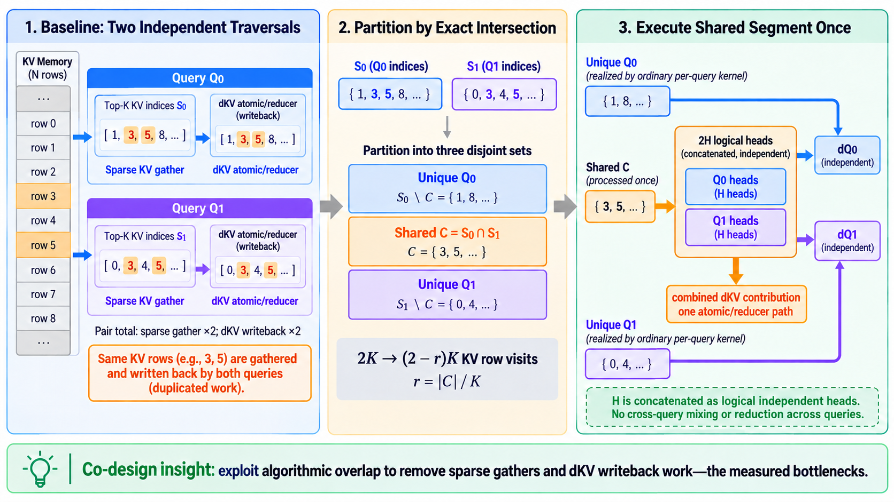

# Co-Designing Sparse Attention Backward Around What the GPU Actually Pays For

Sparse attention is usually introduced as an algorithmic reduction in FLOPs: each query attends to only a Top-K subset of the KV sequence. That description is correct, but it is not enough to predict the performance of the backward pass.

On modern GPUs, our SM100 DeepSeek Sparse Attention (DSA) backward kernels were not primarily limited by tensor-core arithmetic. Profiling pointed to two less glamorous costs: gathering irregular KV rows and atomically accumulating `dKV` back to global memory. At the same time, training traces showed that adjacent queries often selected largely overlapping KV sets.

Those two observations suggest a different optimization question:

> Instead of making each query's kernel slightly faster, can we stop repeating the expensive work shared by neighboring queries?

The result is an adaptive query-pair clustering path for H16/H32, Dqk576 DSA backward. It partitions two adjacent sparse rows into a shared segment and two unique tails, evaluates the shared KV segment once with `2H` logical heads, and combines both queries' `dKV` contributions before writeback.



## TL;DR

- Profiling showed that sparse KV gathers and `dKV` reducer/atomic writeback—not just MMA throughput—set the performance ceiling of DSA backward.
- In a 10-step, 256K-token training experiment, adjacent-query Top-K overlap averaged **70.09% after the initial step**. From step 3 onward, every measured step exceeded 72% mean overlap.
- For adjacent sparse sets `S0` and `S1`, we compute `C = S0 ∩ S1`, keep `S0 \ C` and `S1 \ C` as ordinary per-query work, and process `C` once.
- Concatenating two queries as `2H` logical heads does **not** mix their attention math. `dQ0` and `dQ1` remain independent; only the naturally additive `dKV` contributions are reduced together.
- With equal Top-K size `K` and overlap ratio `r`, ideal KV row visits fall from `2K` to `(2-r)K`. At 70% overlap, that removes up to 35% of the pair's KV visits before accounting for implementation overhead.
- The partition is computed on the GPU into fixed-capacity caller workspace. There is no device-to-host decision, allocation, pointer change, or CUDA Graph rebuild.
- On GB200 at Top-K 2048, the measured high-overlap path reached **1.42× / 1.35× at 80% overlap** and **1.61× / 1.49× at 100% overlap** for H16/H32 respectively.

## The Performance Puzzle

The first clue came from a result that looked counterintuitive. A smaller head count or a larger query tile can reduce the number of loop iterations, but DSA backward latency does not scale down proportionally. Cutting an apparent iteration count in half does not produce anything close to a 2× speedup.

The reason is that an iteration is not just an MMA. Each active sparse index triggers a chain of work:

1. Load an irregular KV row selected by `topk_idxs`.
2. Reconstruct the attention-backward state for that query and head.
3. Produce `dQ` and a contribution to `dKV`.
4. Reduce colliding `dKV` contributions and update global memory.

The tensor-core portion may become shorter while the gather and writeback portions remain. Once those costs dominate, improving only the arithmetic schedule runs into a memory-system and reduction ceiling.

This is the first basis for the co-design: **optimize the work observed on the critical path, not the operation that is easiest to count.**

## Evidence 1: The Kernel Is Bound by Sparse Gather and dKV Writeback

Timeline and counter analysis consistently highlighted two expensive regions.

### Sparse KV gather

Top-K indices address rows spread across a much larger KV sequence. Unlike a dense tile, these loads have weak spatial locality and limited reuse. The kernel cannot assume that adjacent sparse indices map to adjacent cache lines, and the same popular KV row may be fetched independently by many queries.

### dKV reduction and atomic accumulation

`dKV` is a reduction over queries and heads. Different CTAs can contribute to the same KV row, so the backward path uses a reducer and global atomic accumulation. More tensor-core parallelism does not remove this serialization and memory traffic. In practice, the `dKV` generation-to-writeback path occupies a substantial part of the tail and limits how much benefit a compute-only optimization can expose.

This explains why a kernel with fewer MMA-loop iterations may improve only modestly: its arithmetic shrinks, while sparse loads and colliding global updates remain nearly unchanged.

## Evidence 2: Adjacent Queries Reuse the Same KV Rows

The second clue came from the algorithm rather than the GPU.

Nearby tokens usually have related semantic context. A learned sparse indexer therefore has a strong reason to select similar KV rows for adjacent queries. We instrumented a 10-step, 256K-token Ling Tiny v3-style DSA training run on eight B300 GPUs with an H16 indexer, Dqk576, and Top-K 2048. The trace contained 31.46 million non-overlapping adjacent-query pairs.

For valid KV-index sets `A` and `B`, overlap was measured as:

```text
overlap(A, B) = |A ∩ B| / min(|A|, |B|)
```

| Step | Mean overlap | Median | P90 | Mean shared indices |
|---:|---:|---:|---:|---:|
| 0 | 13.18% | 7.71% | 30.57% | 261.9 |
| 1 | 50.51% | 55.18% | 70.51% | 1,026.5 |
| 2 | 62.94% | 66.70% | 78.52% | 1,281.1 |
| 3 | 72.98% | 76.37% | 85.99% | 1,486.7 |
| 4 | 74.46% | 77.25% | 87.21% | 1,516.9 |
| 7 | 75.21% | 80.52% | 87.84% | 1,532.3 |
| 8 | 75.47% | 78.61% | 87.50% | 1,537.7 |
| 9 | 72.50% | 77.29% | 86.13% | 1,476.9 |

After step 0, mean overlap across steps 1–9 was 70.09%. The distribution was not uniform across layers—at step 9, one layer remained near 6.67% while 23 of 24 layers exceeded 50%—so a fixed global assumption would be unsafe. The right design must be adaptive at runtime.

## Turning Overlap Into Less Work

For two adjacent queries, let their active sparse KV sets be `S0` and `S1`. Partition them into three disjoint sets:

```text
C  = S0 ∩ S1
U0 = S0 \ C
U1 = S1 \ C
```

The baseline processes `S0` and `S1` independently. For equal Top-K size `K`, that means `2K` KV row visits. The clustered path processes `U0`, `C`, and `U1`:

```text
|U0| + |C| + |U1| = 2K - |C| = (2-r)K
```

where `r = |C| / K`. The ideal fraction of KV visits removed is therefore `r/2`. A 70% overlap ratio can eliminate up to 35% of the pair's KV-row traffic.

The same partition also attacks the second measured bottleneck. In the baseline, a shared KV row is visited by both queries and enters the `dKV` reducer/atomic path twice. In the clustered path, both contributions are formed together and reduced before one shared writeback path.

## Why the 2H View Is Mathematically Safe

The shared kernel views two adjacent queries as one row with `2H` logical heads:

```text
[Q0 head 0 ... Q0 head H-1 | Q1 head 0 ... Q1 head H-1]
```

This is concatenation, not a reduction across queries. For query `i`, head `h`, and selected KV row `j`, the relevant gradient structure is:

```text
dQ[i,h]  = Σ(j ∈ Si) dS[i,h,j] · K[j]
dKV[j]  += Σ(i : j ∈ Si) Σh contribution(i,h,j)
```

Each logical head still binds to its own `Q`, output, `dO`, LSE, and sink state. The score, probability-gradient, and `dQ` calculations remain query-specific. The shared kernel merely reuses the same gathered KV row while evaluating both independent head groups.

`dKV`, by contrast, is already defined as a sum over queries and heads. Combining the two queries' contributions before the reducer/atomic writeback changes the reduction grouping, not the mathematical result.

This distinction is important:

- **Saved:** duplicate KV gathers, duplicate shared-index traversal, and one `dKV` reducer/atomic path for the shared segment.
- **Not saved:** per-query score math, softmax backward, `dQ` arithmetic, or work in the unique tails.

## Implementation: An Adaptive, Graph-Safe Five-Stage Pipeline

The implementation is opt-in through `q_cluster_mode="adaptive_pair"` for supported SM100/SM103 BF16 H16/H32 Dqk576 configurations.

### 1. Device-side pair transform

One CTA handles each adjacent query pair. A bounded shared-memory hash table computes the exact intersection, rejects duplicate or invalid active indices, and emits:

- a tile-aligned shared segment;
- one unique segment for Q0;
- one unique segment for Q1;
- runtime lengths for all three segments.

The hash table and output capacity depend on Top-K, not the full KV sequence length. The current implementation supports `topk_max <= 2048`.

### 2. Prelude

The ordinary specialization performs the shared setup work: initialize the `dKV` accumulator, compute statistics such as O-dot-dO, and prepare sink-gradient state.

### 3. Unique stage

The original H16 or H32 specialization processes `U0` and `U1` as ordinary per-query sparse rows. This stage owns the initial `dQ` values.

### 4. Shared stage

The shared segment `C` runs once using the paired `2H` view. H16 pairs map to the tuned H32 implementation; H32 pairs map to the generic H64 implementation. The kernel reduces shared-segment `dQ` into the existing per-query outputs and combines both queries' shared `dKV` contributions.

An empty shared segment is a no-op: it must not clear `dQ` produced by the unique stage. This sounds small, but it is a critical ownership invariant in any multi-stage reduction pipeline.

### 5. Epilogue

The accumulated FP32 `dKV` workspace is converted to the output type, and the remaining gradient outputs are finalized.

## Runtime Policy Without Breaking CUDA Graphs

The transform decides independently for every pair whether the shared segment is large enough to amortize the extra launch and generic merged-head path. H16 uses 128-index tiles; H32 uses 64-index tiles with a more conservative threshold because its merged H64 path has different economics.

Low-overlap, duplicate, invalid, or unpaired final rows fall back to ordinary per-query work. Crucially, this decision never returns to the CPU.

The plan reserves fixed-capacity caller-owned workspace and always captures the same transform, prelude, unique, shared, and epilogue topology. Runtime metadata can set a shared length to zero, making the shared launch a no-op while preserving all pointers and launch nodes.

One captured graph was validated while mutating the same Top-K, output, and LSE buffers through:

```text
75% overlap → 0% overlap → 75% overlap
```

For both H16 and H32, the device-side shared lengths changed `384 → 0 → 384` without rebuilding the graph, while the gradients remained aligned with the ordinary baseline.

## What the Measurements Say

On GB200 with BF16, Dqk576, Q=2048, KV=32768, and Top-K 2048, timings included the transform and every backward stage under CUDA Graph replay.

| Pair overlap | H16 speedup | H32 speedup |
|---:|---:|---:|
| 20% | 1.093× | 1.039× |
| 40% | 1.153× | 1.094× |
| 60% | 1.284× | 1.218× |
| 80% | 1.423× | 1.352× |
| 100% | 1.608× | 1.488× |

The crossover is near 20% overlap for this shape. Higher overlap produces a smooth increase because more of the measured gather and writeback work moves into the shared path. Low-overlap pairs still pay the device-side classification cost, which is why the feature remains explicit rather than replacing the default path unconditionally.

The H16 and H32 curves are also not identical. Pairing doubles the logical head count, so H16 can reuse the tuned H32 specialization, while H32 enters a generic H64 path. The savings are algorithmically similar, but the merged kernel's scheduling and occupancy determine how much of those savings reach end-to-end latency.

## Lessons for GPU Kernel Co-Design

### 1. Profiled bottlenecks should shape the algorithmic transformation

If the expensive operations are sparse gathers and atomic writeback, an optimization that only rearranges MMA instructions has a limited ceiling. Removing repeated rows attacks both costs at their source.

### 2. Model-generated sparsity is structured data

Sparse indices are not necessarily random. They are outputs of a learned algorithm and can contain locality worth exploiting. Measuring that structure can reveal transformations invisible from the kernel signature alone.

### 3. Dynamic policy does not require dynamic graph topology

CUDA Graph compatibility requires stable launches and pointers, not constant device data. Preallocate for the maximum capacity, keep the launch sequence fixed, and let GPU metadata select the useful work.

### 4. Ownership matters in multi-stage kernels

When one stage initializes an output and a later stage reduces into it, an empty later stage must preserve the earlier result. Tests need scale-relative checks and explicit nonzero assertions; a generous absolute tolerance can allow an erased gradient to look correct.

### 5. The best unit of optimization may be larger than one query

The original kernel boundary treated each sparse row independently. The workload contained reuse across that boundary. Pairing queries exposes the reuse without changing the public tensor contract or the attention mathematics.

## Outlook: Extending the Idea to H64

The current H32 implementation takes a deliberately pragmatic shortcut. To validate the idea quickly—and, candidly, to avoid designing another kernel from scratch—it concatenates two H32 queries into one logical H64 problem and reuses the existing H64 structure. This gives the shared path a mature kernel mapping while keeping the first implementation small and easy to compare with the ordinary path.

Applying the same idea to an original H64 workload is less straightforward. Pairing two H64 queries creates a logical H128 problem, but simply substituting an existing H128 implementation is unlikely to preserve the same economics. H64 already has a different balance among MMA work, sparse KV gathering, occupancy, and `dKV` reduction; doubling its logical head domain also places substantially more pressure on shared memory and intermediate lifetimes.

A useful H64 design may therefore require rethinking the kernel rather than mechanically widening it. Open questions include:

- how shared KV tiles should be staged and reused without displacing Q/dO, P/dS, or `dKV` buffers from SMEM;
- whether the two queries should share one CTA, cooperate across two CTAs, or use a producer/consumer organization specialized for the common-index segment;
- how to preserve independent `dQ` ownership while combining `dKV` contributions early enough to reduce atomic traffic;
- whether TMEM and SMEM lifetimes can be reorganized so that KV gather, MMA, and the reducer still overlap effectively;
- where the overlap threshold moves once the merged path changes occupancy and shared-memory residency.

In other words, adjacent-query overlap remains an algorithmic opportunity for H64, but realizing it may require a new H64/H128 SMEM layout and pipeline design. That is a natural next co-design problem: retain the same set partition and mathematical invariants, then rebuild the kernel mapping around H64's actual resource bottlenecks.

## Closing

Adaptive query clustering is not primarily a new MMA trick. It is an algorithm–kernel co-design: profiling identifies the hardware costs, training traces identify reusable structure, and the implementation turns that structure into fewer KV visits and fewer `dKV` writeback paths.

The broader lesson is simple: once a kernel is bounded by moving and reconciling sparse data, the next large speedup may come from changing **which work is presented to the kernel**, not only from executing the same work faster.
