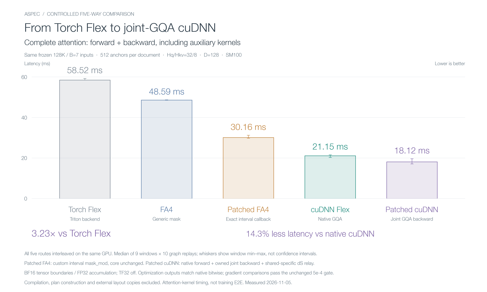
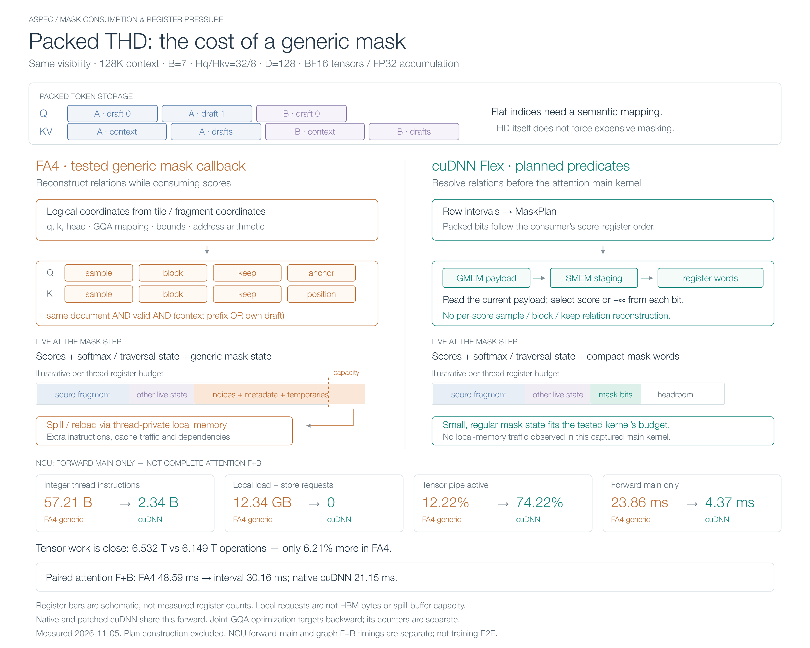

# DSpark Attention: From Flexible Masks to a 3.23× Speedup

Training a speculative draft model produces an attention pattern that looks simple on paper: a context prefix and a small draft block. On a GPU, the interesting part is how that pattern reaches the kernel.

While working on ASpec, we compared Torch FlexAttention, FA4 block sparse, a specialized FA4 mask callback, cuDNN Flex Attention, and an owned cuDNN-derived GQA backward. On one fixed 128K workload, complete attention forward plus backward went from **58.52 ms to 18.12 ms**.

The path between those numbers is useful. It shows three different opportunities: choosing a better execution backend, making mask semantics cheaper to consume, and bringing shared-head gradient contributions together before writing them to global memory.

## TL;DR

- The standard **DSpark/DFlash-style training mask used here** combines a document-local context prefix with one complete draft block. It needs exact, flexible boundaries and also contains regions that can be skipped at tile granularity. This mask structure is shared by the two configurations; it is not unique to DSpark.
- The same-input, interleaved results are **Torch Flex 58.52 ms → FA4 48.59 ms → interval FA4 30.16 ms → cuDNN 21.15 ms → joint-GQA cuDNN 18.12 ms**. Every number is complete attention F+B, including auxiliary kernels.
- The FA4 interval adapter leaves its sparse lists and matrix work unchanged. It removes much of the generic mask's integer, metadata, and live-state overhead. cuDNN moves more mask work into a reusable plan. Joint GQA then removes dK/dV global accumulation buffers and associated work.
- The final path is **3.23× faster than Torch Flex** and reduces latency **14.3% relative to native cuDNN**. Inputs remain BF16 with FP32 accumulation and the same anchor budget. These are attention-kernel results; plan construction and the rest of training are outside the timing boundary.

## Start with the visible region

An anchor identifies a position in a context document. Each anchor expands into `B` draft query rows; here, `B=7`. In the configuration we measured, all seven rows can attend to:

1. Context tokens in their own document, strictly before the anchor.
2. All seven tokens in their own draft block.

They cannot attend to another document, a later context position, or another anchor's draft block. Attention within the draft block is fully visible in this configuration. Causal-within-block or sliding-window variants would change the boundaries.


For a query in anchor block `r` of document `d`, write the visible key positions as:

```math
\mathcal{V}(q) = [c_d, a_r) \;\cup\; [t_r, t_r+B).
```

Here `c_d` is the document's context start, `a_r` its anchor boundary, and `t_r` the start of its own draft block, all in the same flattened key coordinate system. Native THD APIs can instead use sample-local endpoints and cumulative lengths to preserve document ownership.

This is a small union of intervals, but it is not one ordinary causal triangle. Prefix boundaries differ across anchors, and packing adds document boundaries. A flexible mask is necessary.

It is also **partially sparse**. Large context prefixes are dense. Other documents and unrelated draft blocks contain empty regions. At the kernel's chosen tile geometry, a tile can be full, partial, or empty. An empty tile can be omitted; a partial tile still needs an exact predicate for its scores.

The tiny `7×7` draft square can be misleading. Each query also sees a potentially long context prefix. Nor does setting a bitmap bit to zero make a dense Tensor Core MMA skip that individual multiplication. Tile skipping and score masking solve different problems.

## One workload, five execution paths

We fixed ten 4,096-token documents plus documents of 40,960 and 49,152 tokens: **131,072 context tokens** in total. Every original document keeps **512 anchors**, giving 6,144 anchors and 43,008 draft query rows. With draft keys included, KV has 174,080 rows. The head configuration is `Hq/Hkv=32/8`, with head dimension 128.

All five paths receive the same frozen Q/K/V/dO, anchor positions, and visibility. Activations are synthetic. Anchors come from the captured native sampler, which uses strided windows and wraparound; this is not a uniformly sampled or dataset-derived training trace.



| Path | Forward | Backward | Complete F+B |
| --- | ---: | ---: | ---: |
| Torch Flex / Triton | 14.37 ms | 44.32 ms | **58.52 ms** |
| FA4 / generic mask | 23.55 ms | 25.91 ms | **48.59 ms** |
| FA4 / exact interval callback | 8.09 ms | 22.53 ms | **30.16 ms** |
| Native cuDNN Flex / THD | 4.48 ms | 16.01 ms | **21.15 ms** |
| cuDNN forward + owned joint-GQA backward | 4.47 ms | 12.93 ms | **18.12 ms** |

Forward, backward, and F+B were captured and timed independently. Their medians need not add exactly. F+B is the denominator for every headline speedup in this article.

## 1. Torch Flex to FA4: choose the backend, then inspect the split

[Torch FlexAttention](https://pytorch.org/blog/flexattention/) gives us a convenient way to express the mask and compile a fused attention kernel. Its block mask already enables empty-block skipping. It is not a baseline that blindly computes the entire dense matrix and masks it afterward.

The tested FA4 adapter uses the [CuTe DSL implementation](https://github.com/Dao-AILab/flash-attention/tree/main/flash_attn/cute), with separate full/partial block lists and a generic `mask_mod` for partial tiles. It brings a different kernel implementation, tiling, and execution strategy.

The result is an improvement from **58.52 to 48.59 ms**, but the forward/backward split matters: **FA4 forward is slower here**. The total improves because backward drops from 44.32 to 25.91 ms.

This backend comparison is not a one-variable ablation of a particular pipeline feature. It establishes which tested route is faster overall. To understand the expensive FA4 forward, we needed a narrower experiment.

## 2. Specialize the FA4 mask without changing the attention core

The original adapter describes packed visibility through eight metadata inputs:

| Query-side metadata | Key-side metadata | Purpose |
| --- | --- | --- |
| sample | sample | Document isolation |
| block | block | Own draft-block identity |
| keep | keep | Query/key validity |
| anchor | position | Context-prefix visibility |

That is a straightforward representation. A partial-tile callback can ask whether the sample IDs match, whether both positions are valid, and whether the key is in the context prefix or the query's own draft block.

But those relationships can be resolved before the attention call. For this workload, four endpoints describe the exact same region:

```python
visible = (
    (key >= context_start) & (key < anchor)
) | (
    (key >= draft_start) & (key < draft_end)
)
```

We plugged this **exact interval callback into FA4's existing `mask_mod` interface**. We did not change the FA4 attention core, sparse tile lists, or MMA arithmetic. The chart calls it “Patched FA4”; more precisely, it is a specialized adapter.

This alone reduces complete F+B from **48.59 to 30.16 ms**. The forward output is bitwise identical to the generic FA4 path; maximum gradient relative L2 is `9.06e-6`.

NCU shows why the change is substantial:

| Forward-main metric | Generic FA4 | Interval FA4 | Native cuDNN |
| --- | ---: | ---: | ---: |
| BF16→FP32 Tensor Core operations | 6.532 T | **6.532 T** | 6.149 T |
| Integer thread instructions | 57.210 B | **13.974 B** | 2.337 B |
| LSU local load + store requests | 12.343 GB | **4.875 GB** | 0 |
| Tensor pipe active | 12.22% | **36.72%** | 74.22% |

`B=10⁹`, `T=10¹²`; byte units are decimal. The unchanged Tensor Core operation count is important: this control saves work around the matrix multiplications, not the matrix multiplications themselves. It closes **67.2% of the generic-FA4-to-native-cuDNN F+B gap** in this paired run.

Eight metadata inputs do not imply eight HBM transactions for every score. Caching and compiler scheduling matter. The cost also includes addresses, coordinates, comparisons, and how long their intermediate values remain live.

## 3. cuDNN: turn the mask into a consumer-ready plan

cuDNN takes the interval representation further. Its planner builds sparse traversal metadata and packed predicates for partial tiles. The bits are arranged in the order in which the target kernel consumes its score fragment, rather than as a generic row-major bitmap. The kernel can load a word and apply its bits without reconstructing sample and block relationships. The [cuDNN mask-plan design](https://docs.nvidia.com/cudnn/latest/fe-oss-apis/attention/flex_attention_design/) describes that producer/consumer contract.

“Score-register order” means the order of score values held by a consumer thread. One `uint32` represents 32 visibility predicates, not 32 score values. On the tested SM100 forward route, scores move from TMEM to registers, while the current mask payload is staged from GMEM through SMEM into registers.

That difference affects register pressure as well as instruction count. The score fragment must remain live while the mask is applied. A generic callback adds logical-coordinate reconstruction, metadata addresses and values, and temporary state at the same point. FA4's scalar mask path expands calls over the fragment's elements. If the resulting live state exceeds the available register allocation, some values spill to thread-private local memory.

The compiler explicitly reported spills in the tested FA4 paths. An interval callback reduces the pressure, but does not remove every source of local traffic. cuDNN's compact predicate consumption fits this captured forward kernel without observed local reads or writes.



The **4.37 ms** in this diagram is the **NCU-profiled forward main kernel**. It is not the **21.15 ms complete attention F+B** from the performance chart. NCU captures and graph timing windows are separate measurements.

The register bars are schematic, not measured register allocations. Local-request bytes are not HBM bytes or temporary-buffer capacity, and not every local access can be assigned to a particular spilled variable. The native forward's zero does not imply that every cuDNN shape or backward implementation has zero spills. [NCU's memory definitions](https://docs.nvidia.com/nsight-compute/ProfilingGuide/index.html#memory) are helpful here.

There is also a useful negative result behind this choice. FA4 supports packed-vector mask callbacks too; the distinction is not that one library can express exact score masks and the other cannot. The relevant issue is the cost of the tested representation and its consumer. In this run, native cuDNN finishes F+B in **21.15 ms**. FA4 performs only **6.21% more Tensor Core work** than cuDNN in this forward capture, far too small a difference to explain the latency gap by redundant MMA coverage alone.

Planning is not free. These timings reuse prepared plans and exclude construction. If anchors or packed boundaries change, the real training path must account for rebuilding and amortizing that work. The kernel result does not establish the same speedup for an entire training step.

## 4. Joint GQA backward: finish the reduction before writing it out

The last step keeps native cuDNN forward and changes backward ownership.

With 32 Q heads and 8 KV heads, four Q heads share each KV head. Their dK contributions must be summed:

```math
dK_h = \sum_{r=0}^{3} \Delta dK_{h,r}.
```

The native route lets different Q-head work contribute to a shared FP32 global dK accumulator. It clears that buffer, accumulates into it, and later reads, scales, converts, and writes the final gradient. dV has a similar path. This is one shared accumulator per gradient, not four full copies.

At `Tk=174080`, `Hkv=8`, and `D=128`, a single unpadded FP32 dK buffer is **680 MiB**. dV requires the same capacity. Clearing and reading these buffers adds work before counting the main kernel's accumulation updates.

Our owned CuTe DSL backward groups the four Q heads inside a KV-head traversal. Conceptually, virtual query row `4*t+r` reads original `Q[t,4*h+r,:]`. A nested layout expresses that mapping without materializing a reordered Q/dO tensor. The kernel accumulates the group contributions on chip and directly writes dK/dV. FP32 dQ workspace remains.

The implementation is an adaptation of cuDNN Frontend code, with its source and license ancestry retained. It does not patch the installed native baseline. The measured candidate also includes the maintained shared-specific publication in the two-CTA dS relay: it preserves release/acquire ordering while avoiding broader ordering than the shared-memory payload needs.

This combined candidate reduces backward from **16.01 to 12.93 ms** and complete F+B from **21.15 to 18.12 ms**. Forward stays effectively unchanged. We did not separately ablate the relay change in this five-way run, so the 14.3% figure belongs to the combined candidate, not exclusively to dK scratch removal.

Backward NCU observations agree with the direction: DRAM reads fall from **3.580 to 2.585 GB**, writes from **2.402 to 1.649 GB**, and Tensor pipe activity rises from **61.01% to 72.14%**. Tile coverage also changes with grouping. The joint main still has **0.189 GB of local requests**, despite being faster. A zero spill counter is not the optimization objective.

## Benchmark setup

The five paths were interleaved on the same dedicated SM100 GPU. Each route retained nine windows of ten CUDA Graph replays after two discarded windows. Route order rotated and reversed; clocks were unlocked. The chart's whiskers show observed window min–max, not confidence intervals. Joint GQA was faster than native cuDNN in all nine paired F+B windows.

The environment was Python 3.12.3, PyTorch 2.13.0 / CUDA 13, Triton 3.7.1, FA4 4.0.0b34, cuDNN Frontend 1.31.0, CUTLASS DSL 4.7.1, and driver 580.95.05. A cache flush followed by one warm replay preceded each timing window; these are repeated-execution measurements. Compilation, planning, external layout conversion, host dispatch, and the rest of the trainer were excluded.

[The accompanying evidence](pictures/dspark-attention-training/benchmark-evidence.json) retains timing windows, numerical errors, normalized NCU counters, and source identities. [Figure sources and interpretation notes](pictures/dspark-attention-training/README.md) make the diagrams editable and keep their measurement boundaries explicit.

The useful progression was **where information is resolved**. First, skip the empty regions. Then make exact partial-tile masking cheap. Finally, give a KV-head traversal ownership of the gradients that must be reduced together. For this DSpark/DFlash-style mask, those choices moved complete attention from **58.52 to 18.12 ms**, while keeping the same visible scores and supervision budget.

Colleagues have also validated the optimization in end-to-end runs, checking training loss and speculative acceptance. The timings in this article isolate the attention-kernel contribution to that broader training path.
