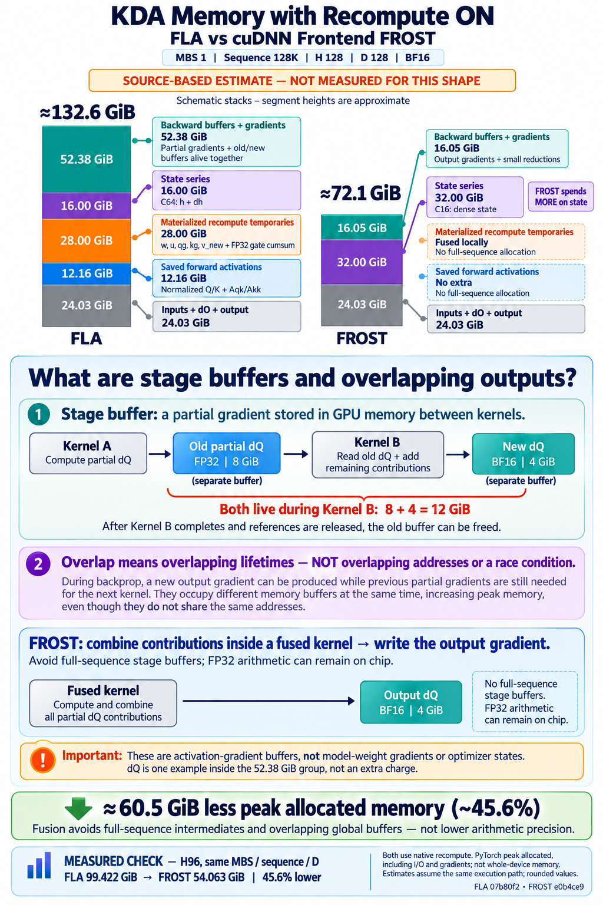

# KDA Memory with Recompute: FLA vs cuDNN Frontend FROST

Both implementations can recompute activations during backward, but recomputation alone does not determine peak memory. In the tested paths, FLA materializes several full-sequence intermediates and keeps old and new gradient buffers alive together. FROST fuses more of this work, avoiding those global arrays even though its dense state series is larger.

The standalone measurements below show approximately **44–46% lower peak allocated memory with FROST**. This is an operator-level result for the pinned implementations and configuration, not a whole-model memory claim or a guarantee for every KDA execution plan.



The main illustration uses a **source-based estimate** for MBS 1, sequence 128K, H128, D128. That exact shape was not measured. Its footer reports the independently measured H96 case. The stack heights are schematic; the numerical labels are the quantities to compare.

## Sources and measurement configuration

Analysis and measurements were completed on October 19, 2026, using a single B300 GPU.

| Implementation | Pinned revision | Selected path |
| --- | --- | --- |
| FLA snapshot | `07b80f2715cf8708680200727ad619e3f4e943b2` | Native Triton KDA, with optional CUDA/FROST dispatch disabled |
| cuDNN Frontend | `e0b4ce989f8d7bc3a10a7432e2d2321f3863863d` | Upstream `kda_frost`, without local kernel modifications |

The FLA revision identifies the snapshot under test; it should not be interpreted as a claim about every FLA release or backend.

Common configuration:

- D128, BF16 Q/K/V, raw gate, raw beta, and upstream output gradient dO.
- FP32 gate parameters `A_log` and `dt_bias`, both initialized to zero.
- In-kernel Q/K L2 normalization, beta sigmoid, and safe gate with lower bound -5.
- Equal-length sequences packed with sequence boundaries; no initial state, final-state output, or final-state gradient.
- All seven tensor inputs differentiated: Q, K, V, raw gate, raw beta, `A_log`, and `dt_bias`.
- FLA uses its native transposed state layout.
- PyTorch 2.12.1, CUDA 13.0, Triton 3.7.1, and CuTeDSL 4.7.0 with the CUDA 13 libraries.
- Identical allocator configuration: `expandable_segments:False`.

Each backend/shape runs in a fresh process with identically seeded inputs. Compilation and bounded warmup precede target-shape warmup. Earlier outputs and gradients are released before measurement. The reported value is the median of three steady-state forward-plus-backward peaks, including inputs, dO, output, gradients, and intermediate tensors. Compilation and finite-value checks are excluded from the measured interval.

These are **PyTorch peak allocated** values, not allocator-reserved bytes or `nvidia-smi` whole-device occupancy. CUDA context memory and allocations outside the PyTorch allocator are excluded. There are no projections, convolutions, optimizer states, model layers, or distributed communication buffers in this experiment.

## Both sides really use recomputation

For FLA, the call explicitly sets `disable_recompute=False`. In `fla/ops/kda/chunk_fwd.py`, forward drops `w`, `u`, `qg`, `kg`, `v_new`, and the chunk state `h` before returning. With gate activation inside the kernel path, it also drops the gate cumulative sum. Backward reconstructs these tensors in `fla/ops/kda/chunk_bwd.py`.

However, FLA still saves normalized Q/K, their normalization statistics, the sigmoid-transformed beta, and the chunk-local matrices `Aqk` and `Akk`. Recompute does not mean saving only the original inputs.

For FROST, `checkpoint_every_n_tokens=0` means forward does not return a saved checkpoint series. The measured backward plan is checked to have `needs_recompute=True`. Backward reconstructs a dense BF16 state series in its workspace; it is **not** a streaming implementation with no full-sequence state allocation.

The two flags therefore select each implementation's native recompute policy, not identical save/recompute boundaries.

## Measured peak allocated memory

Here, 8K means 8,192 tokens and 128K means 131,072 tokens. All rows use D128. Memory is in GiB, where one GiB is 2^30 bytes.

| MBS | Sequence | Heads | FLA peak, GiB | FROST peak, GiB | Reduction |
| ---: | ---: | ---: | ---: | ---: | ---: |
| 8 | 8K | 16 | 8.285 | 4.510 | 45.6% |
| 1 | 8K | 64 | 4.143 | 2.303 | 44.4% |
| 1 | 8K | 96 | 6.214 | 3.394 | 45.4% |
| 1 | 8K | 128 | 8.285 | 4.524 | 45.4% |
| 2 | 8K | 64 | 8.285 | 4.516 | 45.5% |
| 2 | 8K | 96 | 12.428 | 6.774 | 45.5% |
| 1 | 128K | 96 | 99.422 | 54.063 | 45.6% |

For the 128K/H96 pair, the peaks were identical across all three repetitions. Both backward passes completed without OOM, and every output and input gradient was finite. FROST's plan was uncut, not chain, and used recomputation.

The corresponding peak reserved memory was 99.893 GiB for FLA and 54.064 GiB for FROST. This distinction matters: the main table is about live allocated storage, not merely the caching allocator retaining unused blocks.

Finite checks are **not** a cross-implementation numerical-accuracy audit. No native precision settings were modified, but these measurements do not establish bitwise equality or reference-error parity. Other long-context combinations, including all 256K cases, were not measured.

## Where FLA's memory goes

For MBS 1, sequence 128K, H128, D128, one full-sequence `[S,H,D]` tensor contains 2,147,483,648 elements:

- BF16 storage: **4 GiB**.
- FP32 storage: **8 GiB**.

The following is a source-based live-storage reconstruction assuming the same uncut execution path as the measured H96 case. It is not an actual H128 measurement. Values are rounded; a buffer is counted only once in the grouping.

| Storage group | FLA estimate, GiB | FROST estimate, GiB | Explanation |
| --- | ---: | ---: | --- |
| Inputs, dO, and output O | 24.031 | 24.031 | Common storage included in the measurement |
| Extra forward-saved activations | 12.156 | 0 | FLA normalized Q/K, `Aqk/Akk`, and small saved statistics |
| Materialized recompute intermediates | 28.000 | No separate full-sequence arrays | FLA `w/u/qg/kg/v_new` total 20 GiB; FP32 gate cumulative sum adds 8 GiB |
| State series | 16.000 | 32.004 | FLA C64 `h` plus `dh`; FROST C16 dense state series |
| FP32 stage buffers `dq/dk/dg` | 24.000 | No separate full-sequence arrays | Partial gradients passed between FLA stages |
| FP32 `dAqk/dAkk` | 8.000 | No separate full-sequence arrays | Gradients of chunk-local matrices, not model weights |
| Current `dv` | 4.000 | 4.000 | BF16 V-gradient buffer |
| New intra outputs / corresponding FROST output gradients | 16.000 | 12.000 | FLA BF16 `dq2/dk2` and FP32 `dg2`; FROST BF16 `dQ/dK/dG` |
| Beta gradients and reduction temporaries | 0.375 | About 0.031 | FLA also has partitioned beta-gradient storage |
| Gate-parameter reduction scratch and small metadata | Small | About 0.016 | FROST partial reductions and scheduling metadata |
| **Estimated total** | **About 132.6** | **About 72.1** | **About 60.5 GiB, or 45.6%, lower** |

The illustration groups the backward-buffer rows starting with FP32 stage buffers into approximately **52.38 GiB for FLA** and **16.05 GiB for FROST**. The group includes both temporary partial gradients and output storage. It is not all additional memory on top of the total.

For the measured H96 case, the same FLA source-lifetime reconstruction sums to within approximately 1.6 KiB of the measured 99.422 GiB peak. That agreement supports the explanation, but is not a substitute for an allocation-by-allocation timeline or a measurement of H128.

## What are FP32 stage buffers and overlapping outputs?

A **stage buffer** is a partial result written to GPU global memory by one kernel and read by another. For example, one backward stage produces only part of dQ; another stage adds the remaining contribution.

An **overlapping output** means the old partial result and the new result are alive at the same time. It describes overlapping lifetimes, not overlapping addresses, a data race, or concurrent kernel execution.

For the estimated H128 example:

```text
Kernel A computes a partial dQ
              |
              v
Old partial dQ: FP32, 8 GiB
              |
              v
Kernel B reads the old partial dQ and adds remaining contributions
              |
              v
New dQ: BF16, 4 GiB, in a separate allocation

During Kernel B: old 8 GiB + new 4 GiB = 12 GiB live
```

The old allocation cannot be reused for the new result while the kernel still needs to read it, unless the implementation explicitly supports safe in-place processing. Moreover, the Python caller may still hold the old tensor reference after its last GPU consumer. Completion of a GPU read does not automatically release the allocation.

In this FLA snapshot, `chunk_kda_bwd_wy_dqkg_fused` allocates FP32 `dq`, `dk`, and `dg`. Then `chunk_kda_bwd_intra` allocates new `dq2`, `dk2`, and `dg2` while the earlier buffers remain referenced by its caller. Several recomputed intermediates also remain referenced in the surrounding backward function. This combination extends the live set at the peak.

These are **activation gradients**, not a model's persistent parameter-gradient or optimizer-state allocation. The dQ example is already included in the memory table, not another 12 GiB to add.

## Why the larger FROST state series still wins

State storage alone points in the opposite direction:

- FLA stores C64 chunk states `h` and state gradients `dh`: about 8 GiB each in the estimated H128 example.
- FROST recomputes a C16 dense state series: about 32 GiB, including a small boundary-row allowance.

FROST therefore spends approximately **16 GiB more on state storage**, but avoids more storage elsewhere: normalized-input copies saved across forward/backward, full-sequence recompute intermediates, chunk-matrix gradients, and overlapping stage-gradient arrays.

Its tested equal-head path writes final gradients in their input dtypes and uses a small parameter-reduction workspace. Partial calculations can remain in registers or other on-chip storage instead of becoming full-sequence global arrays. **Avoiding a full-sequence FP32 array does not mean avoiding FP32 arithmetic.** It also does not imply zero register, shared-memory, or other workspace cost.

This is an implementation-specific fusion and tensor-lifetime advantage, not a fundamental limitation of Triton or linear attention. Earlier release of dead intermediates, safe buffer reuse, or additional fusion could change the FLA memory profile, but would require separate correctness, numerical, and performance validation.

## Source-reading map

The FLA paths below refer to the pinned snapshot, not an assumed public repository location:

| Source | Relevant behavior |
| --- | --- |
| `fla/ops/kda/chunk.py`, lines 59–63 and 124–127 | Normalize Q/K and save tensors for backward |
| `fla/ops/kda/chunk_fwd.py`, recompute cleanup near line 126 | Drop selected intermediates before returning forward |
| `fla/ops/kda/chunk_bwd.py`, recompute branch near line 453 | Rebuild full-sequence intermediates and state |
| `fla/ops/kda/wy_fast.py`, lines 229–232 | Allocate `w`, `u`, `qg`, and `kg` |
| `fla/ops/common/chunk_delta_h.py`, forward/backward host wrappers | Allocate C64 `h`, `dh`, and value buffers |
| `fla/ops/kda/chunk_bwd.py`, lines 336–337 and 386–391 | Allocate matrix gradients and FP32 stage buffers |
| `fla/ops/kda/chunk_intra.py`, lines 863–897 | Allocate new intra outputs and beta-gradient reduction storage |

For cuDNN Frontend, the pinned public sources are:

- [KDA Python wrapper and autograd setup](https://github.com/NVIDIA/cudnn-frontend/blob/e0b4ce989f8d7bc3a10a7432e2d2321f3863863d/python/cudnn/linear_attention/ops/kda.py): original-input saving and output-gradient allocations.
- [FROST KDA engine](https://github.com/NVIDIA/cudnn-frontend/blob/e0b4ce989f8d7bc3a10a7432e2d2321f3863863d/python/cudnn/linear_attention/frost/kda_engine.py): recompute selection, dense checkpoint workspace, and reduction scratch.

## Takeaway

**Recompute reduces what must survive from forward to backward; fusion and tensor lifetimes determine how much must coexist during backward.** In these tested paths, FROST's larger state allocation is more than offset by avoiding FLA's many full-sequence intermediates and overlapping gradient buffers.
